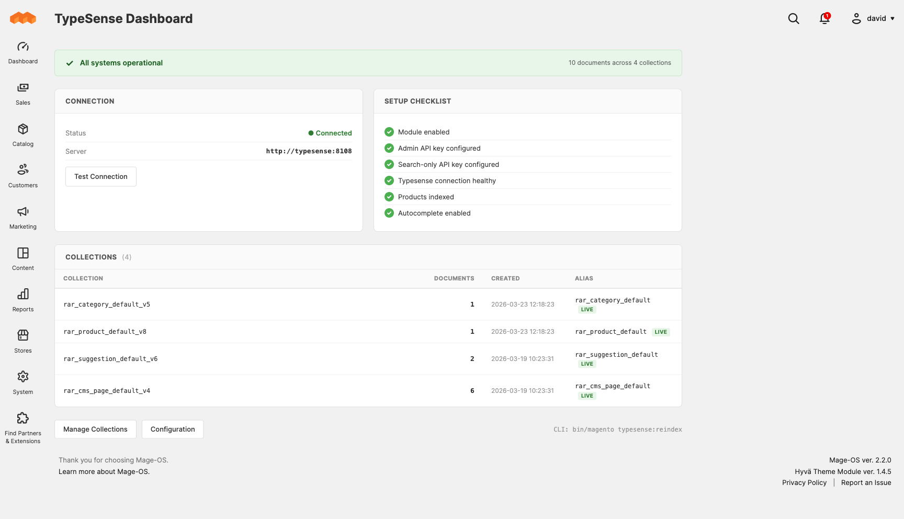
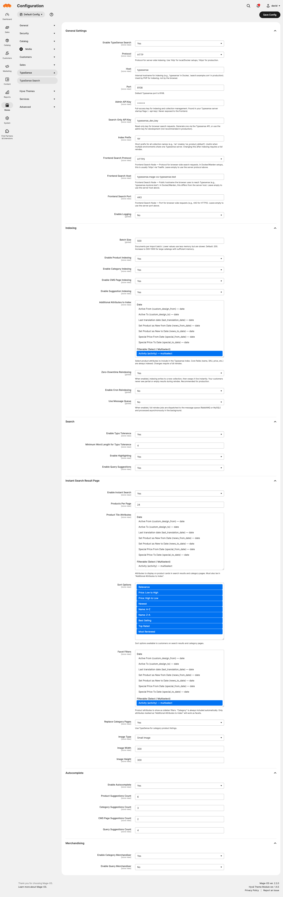
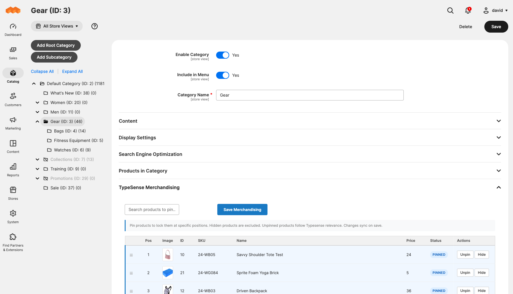
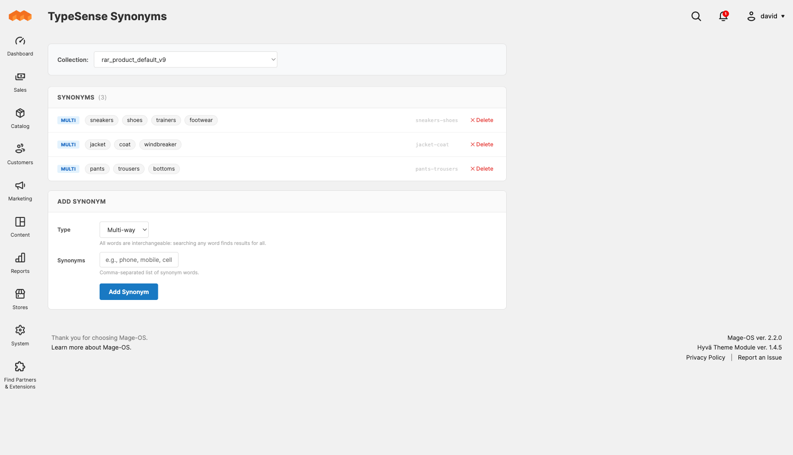
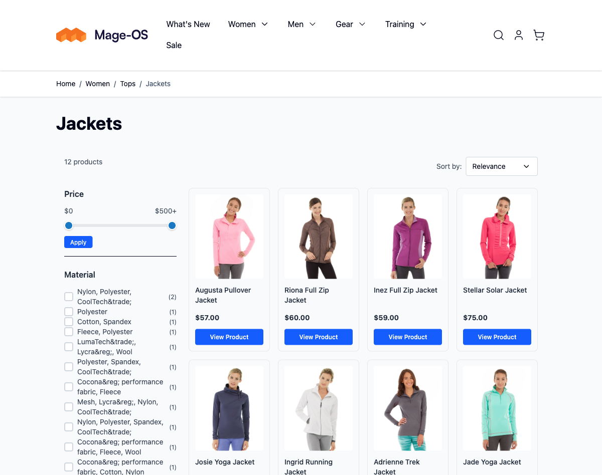

# RunAsRoot Magento 2 TypeSense

[](https://github.com/run-as-root/Typesense-Magento-2/actions/workflows/ci.yml)
[](https://github.com/run-as-root/Typesense-Magento-2/actions/workflows/e2e.yml)


Open-source [Typesense](https://typesense.org) search integration for Magento 2 / Mage-OS with visual merchandising, zero-downtime reindexing, and Hyva-native frontend components.

---

## Screenshots

### Admin Dashboard


### Admin Configuration


### Collection Browser


### Visual Category Merchandiser


### Synonym Management


### Frontend — Category Page


---

## Features

- Full-text search powered by Typesense with typo tolerance and instant results
- Zero-downtime reindexing using collection versioning and atomic alias swaps
- Multi-entity indexing: products, categories, CMS pages, search suggestions, orders, customers, store, and system config
- Hyva-compatible autocomplete (CSP-safe Alpine.js) with multi-index results, the top hit's cross-sells and popular searches
- Instant search page replacing the default Magento catalog search
- Category page powered by Typesense with client-side filtering and sorting
- Visual category merchandiser on the category edit page (Algolia-style sortable product table)
- Virtual categories with rule-based product membership, resolved at query time with no reindex required
- Admin query merchandiser for keyword-level product promotion/demotion
- Boosting rules that raise or lower products matching admin-built conditions in the relevance order
- Relevance tuning: weighted searchable attributes, typo/prefix/split-join parameters, infix search, stemming, German decompounding and direct matches ranked above synonym matches
- Admin synonym manager and collection browser
- Category listings in the merchandised order (Magento category positions)
- CLI commands for reindexing, collection management, health checks and the ElasticSuite migration
- Cron-based and message-queue-based background reindexing
- Conversational search (RAG) with AI-generated answers powered by OpenAI + Typesense embeddings
- Product recommendations on the product detail page using vector similarity search
- Admin AI Assistant with 24 agentic analytics tools (customer segmentation, inventory forecasting, cohort analysis, and more)
- CSP whitelist for Typesense API endpoints
- Configurable per store view

---

## Requirements

| Dependency | Version |
|---|---|
| PHP | 8.3+ |
| Magento 2 / Mage-OS | 2.4.7+ |
| Magento Inventory (MSI) modules | enabled (product stock comes from `IsProductSalableInterface`) |
| Typesense | 27+; search suggestions need 29.x with search analytics enabled ([Search Suggestions](#search-suggestions)) |
| Hyva Theme | 1.3+ |
| typesense/typesense-php | ^6.0 |
| run-as-root/german-compound-splitter | ^1.0 |

---

## Installation

Until both packages are published on Packagist, add their GitHub repositories to your project first:

```bash
composer config repositories.magento2-typesense vcs https://github.com/run-as-root/Typesense-Magento-2
composer config repositories.german-compound-splitter vcs https://github.com/run-as-root/german-compound-splitter
```

```bash
composer require run-as-root/magento2-typesense
bin/magento setup:upgrade
bin/magento setup:di:compile
```

For production:

```bash
bin/magento setup:static-content:deploy
bin/magento cache:flush
```

---

## Configuration

Navigate to **Stores > Configuration > TypeSense > TypeSense Search**.

### General Settings

| Setting | Default | Description |
|---|---|---|
| Enable TypeSense Search | No | Master switch for the module |
| Protocol | http | `http` or `https` for server-side (PHP) requests |
| Host | localhost | Internal hostname for indexing (e.g., `typesense` in Docker) |
| Port | 8108 | Typesense server port |
| Admin API Key | — | Server-side admin key (never exposed to frontend) |
| Search-Only API Key | — | Public key used for frontend search requests |
| Frontend Search Protocol | — | Override protocol for browser-side requests (useful in Warden/Docker setups) |
| Frontend Search Host | — | Public hostname the browser uses to reach Typesense |
| Frontend Search Port | — | Override port for browser-side requests |
| Index Prefix | rar | Prefix for all collection names |
| Enable Logging | No | Logs search queries and indexing activity |

#### Search-only key scope

The search-only key is sent to every visitor's browser, so it must allow only `documents:search` on the storefront collections: `product`, `category`, `cms_page` and `suggestion`. When enabled for the admin assistant, the module also indexes customers, orders, stores and system config into the same Typesense server; a key with `"collections": ["*"]` would let anyone read those.

Create the key with the admin key (replace `rar` with your Index Prefix):

```bash
curl "https://typesense.example.com/keys" -X POST \
  -H "X-TYPESENSE-API-KEY: ${TYPESENSE_ADMIN_API_KEY}" \
  -H "Content-Type: application/json" \
  -d '{
    "description": "Storefront search",
    "actions": ["documents:search"],
    "collections": ["rar_(product|category|cms_page|suggestion)_.*"]
  }'
```

Typesense treats each `collections` entry as a regular expression that must match the whole requested name, so this entry matches the live aliases (`<prefix>_<entity>_<store code>`, e.g. `rar_category_de`) and the versioned collections behind them (`rar_category_de_v3`), but not `rar_customer_de` or `rar_order_de`. Use one entry per prefix when store views use different Index Prefixes. Instead of a pattern you can list the alias names explicitly (`rar_product_de`, `rar_category_de`, `rar_cms_page_de`, `rar_suggestion_de`, … for every store view); the browser always searches the alias, but the key then has to be recreated whenever a store view is added.

### Indexing Settings

| Setting | Default | Description |
|---|---|---|
| Batch Size | 200 | Documents per import batch |
| Index Products | Yes | Enable product indexing. Every flag applies per store view to full reindexes (cron, queue, CLI) and mview updates |
| Index Categories | Yes | Enable category indexing |
| Index CMS Pages | Yes | Enable CMS page indexing |
| Enable Customer / Order / Store / System Configuration Indexing | No | Admin assistant collections ([Additional Indexers](#additional-indexers)). Customers and orders carry names, e-mail and postal addresses: keep them off unless the assistant needs them |
| Enable Search Suggestions | Yes | Suggestion collection and analytics rule per store view ([Search Suggestions](#search-suggestions)) |
| Suggestion Limit | 1000 | How many of the most frequent queries a store's suggestion collection keeps (analytics rule `limit`); also the seed maximum |
| Suggestion Minimum Count | 3 | Count a query needs before it is shown in suggestions and popular searches |
| Suggestion Maximum Length | 60 | Longer queries are deleted and never shown |
| Blocked Suggestion Words | — | One word or word part per line, case-insensitive; matching queries are deleted and never shown |
| Suggestion Check Schedule | `20 * * * *` | Cron schedule of the suggestion check (`typesense_suggestion_prune`); new queries are hidden until it has run |
| Additional Attributes to Index | — | Extra product attributes to include in the Typesense index (see below) |
| Zero-Downtime Reindex | Yes | Use alias swap strategy for live reindexing |
| Enable Cron Reindex | No | Schedule automatic reindexing |
| Cron Schedule | `0 2 * * *` | Cron expression for scheduled reindex |
| Enable Queue Reindex | No | Use message queue for async reindexing |

### Search Settings

Store-view scope. These drive the search page, autocomplete product results and (with "Replace Category Pages") category listings. Settings marked "Reindex" change the collection schema: run `bin/magento typesense:reindex --entity=product` after changing them. Searches can fail until that reindex has finished. Schema changes (infix, stemming, decompounding) only take effect with Zero-Downtime Reindex enabled, which builds a new collection; without it the existing collection is reused, so delete it first (`typesense:collection:delete`). A full reindex whose schema differs from the previously live collection cleans the full page cache by itself, because cached pages still send the old search parameters; flush it manually after changing settings that need no reindex.

| Setting | Default | Description |
|---|---|---|
| Enable Typo Tolerance | Yes | `num_typos` 2 when on, 0 when off |
| Text Match Type | Max Weight | How the text-match score is combined across fields (`text_match_type`: `max_weight`, `max_score`, `sum_score`) |
| Searchable Attributes | name 10, sku 9, description 1 | Rows of attribute + weight; become `query_by` / `query_by_weights` in weight order. Options are name, SKU, description, short description, categories, "Name (decompounded)", "Child Products" and every additional indexed attribute. Attributes that are not indexed are dropped; an empty list falls back to `name`. "Child Products" (`children_text`, the names and SKUs of a composite product's children) is always searched: without a row of its own it gets the weight of `name` |
| Drop Tokens Threshold | 0 | Drop query words when fewer results than this are found (0 disables) |
| Typo Tokens Threshold | 1 | Search typo-corrected matches only when exact matches return fewer results than this |
| Minimum Word Length for 1 Typo | 5 | `min_len_1typo` (shown when typo tolerance is on) |
| Minimum Word Length for 2 Typos | 8 | `min_len_2typo` (shown when typo tolerance is on) |
| Prioritize Exact Matches | Yes | `prioritize_exact_match` |
| Split/Join Words | Fallback | Match "smart watch" against "smartwatch" (`split_join_tokens`: `fallback`, `always`, `off`) |
| Enable Prefix Search | Yes | Match the last query word as a prefix |
| Exhaustive Search | No | `exhaustive_search` on every storefront product search: Typesense considers all token variants (typos, prefixes) instead of stopping once it has enough matches. Recommended for small catalogs (a few thousand products or fewer), where the default can miss products (e.g. 54 instead of 83 hits for "marille" on ~430 products). Large catalogs can instead raise Typesense's `max_candidates` (default 4) with a theme plugin on `SearchParametersProvider::getParameters()`, which widens the search without considering every variant. No reindex |
| Enable Infix Search | No | Match query words inside other words. Reindex |
| Infix Search Fields | name | Fields that get the infix flag; the `infix` request parameter is `off` for every other `query_by` field. Reindex |
| Infix Search Mode | Fallback | `fallback` uses infix matching only when the normal search finds nothing; `always` combines both |
| Enable Stemming | Yes | `stem` flag on the full-text fields (name, description, short description, categories text, "Name (decompounded)"), so word variants match. SKU, category paths, type and additional (facet) attributes are never stemmed, so their filters stay exact. Reindex |
| Show Direct Matches First | Yes | Products matching the query itself rank above synonym-only matches (search page and autocomplete, relevance sort only). Costs one extra search per query |
| Enable Server-Side Search Cache | Yes | Typesense caches identical search requests in memory (`use_cache`) |
| Search Cache TTL (seconds) | 300 | `cache_ttl` |
| Boosting Rule Text Match Buckets | 10 | `_text_match(buckets: N)` used with boosting rules (see [Boosting Rules](#boosting-rules)) |
| German Decompounding | No | Index the product name plus the tails of its German compound words ("Treppensackkarre" → "Treppensackkarre Sackkarre Karre") in `name_decompounded`. Add "Name (decompounded)" to Searchable Attributes to search it, but only after the full reindex has finished: a row added earlier makes every search in the store fail. Reindex |
| Never Split Words Of | — | Product attribute whose words (e.g. a product line name) are never split. Reindex |

### Instant Search Settings

| Setting | Default | Description |
|---|---|---|
| Enable Instant Search | Yes | Replace the Magento search results page |
| Products Per Page | 12 | Results per page on the search results page |
| Product Tile Attributes | — | Attributes displayed on product cards (must also be indexed) |
| Sort Options | relevance, price asc/desc, newest | Sort options available to customers, including attribute options such as "Alcohol Vol.-%" (see below) |
| Facet Filters | — | Facets shown in the filter bar: additional attributes plus Price, Availability (`in_stock`) and New (`is_new`). The category filter is always added first (see [Category facet](#category-facet)); `categories.lvl0`/`lvl1`/`lvl2` or `category_ids` in this list are ignored. The search page leaves out attributes (Price included) whose "Use in Search Results Layered Navigation" is No. The price slider is hidden when all results have the same price |
| Facet Types | — | Per facet: dropdown, checkbox (Yes/No fields) or slider (Price only), and "Value Search" for dropdowns. Price defaults to a slider |
| Show Out-of-Stock Products Last | Yes | Sorts by `in_stock:desc` before the chosen sort |
| Replace Category Pages | No | Use Typesense for category product listings (not for "Static block only" categories) |
| Cacheable Search Page | Yes | Serve the search page as a full-page-cacheable shell; search terms are logged from the browser |
| Image Type | `category_page_grid` | Magento image id used for the indexed, resized `image_url` |
| Image Width / Height | 300 | `width`/`height` attributes of tile images |
| No Results: Suggested Products Category ID | — | Products of this category are shown below the "no results" message |
| SEO Text Selector | `.page-bottom .category-description` | Element hidden on category pages after the first page |

### Autocomplete Settings

| Setting | Default | Description |
|---|---|---|
| Enable Autocomplete | Yes | Show autocomplete dropdown on search input |
| Product Count | 6 | Max product results in autocomplete |
| Category Count | 3 | Max category results |
| CMS Page Count | 2 | Max CMS page results |
| Suggestion Count | 4 | Max query suggestion results |
| Group Products By | — | Faceted product field sent as `group_by` (one product per value); ignored when not a faceted schema field |
| Product Meta Line Fields | — | Comma-separated document fields shown below a product row's name, joined with " · " (see [Meta lines](#meta-lines)) |
| Show Cross-Sells of the Top Hit | No | "Goes well with" cards: the first product hit's Magento cross-sells (see [Cross-sells](#cross-sells)) |
| Cross-Sell Count | 4 | Number of cross-sell cards |
| Cross-Sell Fallback Attribute | — | Product field whose values the fill-up products share with the top hit; empty = no fill-up; ignored when not in the product schema |
| Cross-Sell Fallback Sort | `sales_count:desc` | Typesense `sort_by` of the fill-up products |
| Cross-Sell Meta Line Fields | — | Like Product Meta Line Fields, for the cross-sell cards |
| Popular Searches Count | 0 | The store's most popular search terms, also shown on focus with an empty input; 0 = off |

### Tracking Settings

| Setting | Default | Description |
|---|---|---|
| Push GA4 Events to the dataLayer | No | Maps the `typesense:*` window events to `view_item_list`, `select_item`, `search_suggestion_click`, `sorting_interaction` and `filter_interaction` |

### Conversational Search (AI) Settings

| Setting | Default | Description |
|---|---|---|
| Enable Conversational Search | No | Show AI-generated answers above search results |
| OpenAI API Key | — | API key for answer generation (get one at platform.openai.com) |
| OpenAI Model | gpt-4o-mini | Model used for generating answers |
| System Prompt | — | Instructions for the AI assistant's tone and behavior |
| Embedding Source Fields | name, description | Product fields used to generate semantic embeddings |
| Conversation TTL | 86400 | How long conversation history is kept (seconds) |

### Product Recommendations Settings

| Setting | Default | Description |
|---|---|---|
| Enable Recommendations | No | Show similar products on the product detail page |
| Number of Products | 8 | Maximum recommended products to display |

> **Note:** Product Recommendations require Conversational Search to be enabled, as they use the same product embeddings for vector similarity search. The admin UI enforces this: the Product Recommendations fields are hidden until Conversational Search is turned on, keeping the admin state aligned with the backend gate (`isRecommendationsEnabled()`).

### Admin AI Assistant Settings

| Setting | Default | Description |
|---|---|---|
| Enable Admin AI Assistant | No | Activate the agentic AI chat in the admin panel |
| System Prompt | — | Instructions for the AI assistant's tone, behavior, and data model context |
| OpenAI Model | gpt-4o | Model used for function calling and answer generation (inherits from Conversational Search if empty) |
| Conversation TTL | 86400 | How long conversation history is retained (seconds) |

> **Note:** The Admin AI Assistant requires Conversational Search to be enabled with a valid OpenAI API key. The assistant uses the same API key configured under Conversational Search.

---

## Configurable Attributes

### Additional Attributes to Index

Navigate to **Stores > Configuration > TypeSense > TypeSense Search > Indexing > Additional Attributes to Index**.

Select any product attributes you want included in the Typesense product documents. Core fields (name, SKU, price, description, URL, images, categories) are always indexed. Use this to add attributes like `color`, `size`, `brand`, `material`, or any custom attribute.

Attributes are grouped by input type (select/multiselect, boolean, numeric, text) so you can quickly identify which ones make sense to index or use as facets. Each entry shows the attribute label, code, and input type — for example: `Color (color) — select`.

Changes to this setting require a full product reindex to take effect.

Each attribute is a `string[]` field (option attributes by label). A composite product (grouped, configurable or bundle) holds the distinct values of its own and of its children: the enabled children linked in `catalog_product_relation` that belong to the store's website, whatever their visibility, as in Magento's and ElasticSuite's indexes. A grouped "Jagertee" whose 0.02 l size has the trade name "Likör" is found by the `trade_name` filter "Likör" and counted in its facet. The children's names and SKUs go into `children_text`, which is searched with the weight of `name` (the lowest weight when `name` is not searched) unless Searchable Attributes has a "Child Products" row of its own. Prices stay the cheapest child's. Children are loaded once per indexing batch.

### Product Tile Attributes

Navigate to **Stores > Configuration > TypeSense > TypeSense Search > Instant Search > Product Tile Attributes**.

Select which attributes from your indexed set should be visible on product cards in search results and category pages. An attribute must appear in "Additional Attributes to Index" before it can be displayed on tiles.

### Sort Options

Navigate to **Stores > Configuration > TypeSense > TypeSense Search > Instant Search > Sort Options**.

Choose which sort options are available to customers on search results and category pages. Available options:

| Option | Description |
|---|---|
| Relevance | Default Typesense relevance ranking |
| Price: Low to High | Ascending price |
| Price: High to Low | Descending price |
| Newest | Most recently created products |
| Name: A–Z | Alphabetical ascending |
| Name: Z–A | Alphabetical descending |
| Best Selling | Based on sales order data |
| Top Rated | Based on review ratings |
| Most Reviewed | Based on review count |
| *Attribute* (ascending / descending) | One pair per product attribute with "Used for Sorting in Product Listing" = Yes (e.g. "Alcohol Vol.-% (ascending)", key `attr:volume_percent:asc`) |

Options appear in the order they are configured (store-view scope).

**Attribute sort options.** Typesense cannot sort on the `string[]` attribute fields, so every attribute with a configured sort option also gets a single-valued, sortable field `<code>_sort` (and is indexed like an additional attribute even when it is not listed there). Its type follows the attribute: `float` for select/multiselect attributes whose option labels are all numbers, optionally with a unit ("40.0 %", "0,7 l"), and for other `decimal`/`int` attributes; `string` otherwise. The value is the product's own value; a composite product without one takes the lowest value of its children (a multiselect also its lowest). Products without a value sort last in both directions. The storefront label is the attribute's store label, with ": Low to High" / ": High to Low" when both directions are enabled. On category pages the attribute options follow the category's "Available Product Listing Sort By" (the attribute code, e.g. `volume_percent`), and a category whose "Default Product Listing Sort By" is the attribute opens with its ascending option. Adding an attribute sort option needs a full product reindex (`bin/magento typesense:reindex --entity=product`); the reindex cleans the full page cache.

---

## CLI Commands

| Command | Description |
|---|---|
| `bin/magento typesense:reindex [--entity=TYPE]` | Reindex all or a specific entity type into Typesense. Storefront types: `product`, `category`, `cms_page`, `suggestion`; admin search types: `customer`, `order`, `store`, `system_config`. Without `--entity` every type enabled under Indexing is reindexed; customer, order, store and system config are off by default (see [Search-only key scope](#search-only-key-scope)). A disabled type is reported as skipped |
| `bin/magento typesense:collection:list` | List all Typesense collections with document count and alias mappings |
| `bin/magento typesense:collection:delete <name> --force` | Delete a named Typesense collection |
| `bin/magento typesense:collection:delete --entity=TYPE --force` | Delete the aliases and all collections (versioned and plain) of an entity type in every store view; refused while the type is still enabled in a store view |
| `bin/magento typesense:health` | Check the health status of the Typesense server |
| `bin/magento typesense:import:elasticsuite [--synonyms] [--boosts] [--positions] [--dry-run] [--store=CODE]` | Import ElasticSuite thesauri, optimizers and category positions, see [Migrating from ElasticSuite](#migrating-from-elasticsuite) |
| `bin/magento typesense:suggestions:seed [--limit=N] [--store=CODE]` | Import the most popular Magento search terms into the suggestion collections; terms already present keep their count, so it can run again, see [Search Suggestions](#search-suggestions) |

### Examples

```bash
# Full reindex of all enabled entity types
bin/magento typesense:reindex

# Remove the customer collections built before customer indexing was disabled
bin/magento typesense:collection:delete --entity=customer --force

# Reindex only products
bin/magento typesense:reindex --entity=product

# List collections to inspect index state and verify alias assignments
bin/magento typesense:collection:list

# Check server connectivity before indexing
bin/magento typesense:health

# Create the suggestion collections and analytics rules, then import the top 500 Magento search terms of one store view
bin/magento typesense:reindex --entity=suggestion
bin/magento typesense:suggestions:seed --store=de --limit=500
```

---

## Indexing

### How It Works

The indexer pipeline is split into three layers:

1. **EntityIndexer** — per entity type; fetches records and builds document arrays
2. **IndexerOrchestrator** — coordinates collection creation, batched import, and alias management
3. **BatchImportService** — chunks documents and sends them to Typesense's bulk import API

### Entity Types

| Entity | Collection Pattern | Magento Indexer ID |
|---|---|---|
| Products | `<prefix>_product_v<n>` | `typesense_product` |
| Categories | `<prefix>_category_v<n>` | `typesense_category` |
| CMS Pages | `<prefix>_cms_page_v<n>` | `typesense_cms_page` |
| Suggestions | `<prefix>_suggestion_<store code>` (not versioned, written by Typesense) | `typesense_suggestion` |
| Orders | `<prefix>_order_v<n>` | `typesense_order` |
| Customers | `<prefix>_customer_v<n>` | `typesense_customer` |
| Store | `<prefix>_store_v<n>` | `typesense_store` |
| System Config | `<prefix>_system_config_v<n>` | `typesense_system_config` |

Collections are suffixed with a version number (e.g., `rar_product_v2`) so that the live collection pointed to by the alias is never written to during a reindex.

Every store view gets its own collections, behind the alias `<prefix>_<entity>_<store code>`. A store view's category collection holds only the active categories below that store's root category, with the names, URLs and status of that store view; its CMS page collection holds the pages assigned to the store view or to all store views, and its suggestion collection the queries searched on the store view's product collection.

### Zero-Downtime Reindexing

When zero-downtime reindexing is enabled:

1. `ZeroDowntimeService::startReindex()` creates a new versioned collection (e.g., `rar_product_v2` while `rar_product` alias points at `rar_product_v1`)
2. All documents are indexed into the new versioned collection
3. `ZeroDowntimeService::finishReindex()` re-creates the synonyms and merchandising overrides on the new collection, atomically swaps the alias to point at it, keeps the previously live collection as a rollback target, and deletes older versions. If the synonyms or overrides cannot be re-created, the alias is not swapped: the new collection is deleted and the reindex fails (non-zero exit code, cron error log), so the live search keeps its synonyms. Only the first build of a collection, with nothing live yet, goes live anyway

When the new collection's schema differs from the one that was live (new or changed fields, including category position fields), the reindex cleans the full page cache and the cached field list of that collection once all store views are done.

This means the live alias (`rar_product`) always points at a fully populated collection. If a new version turns out bad, `bin/magento typesense:collection:rollback --entity=<type> --store=<code>` points the alias back to the previous version.

### Magento Indexer Integration

The module registers standard Magento indexers and supports incremental updates via MView (MySQL change log). After configuration changes or new product saves, the relevant indexer is flagged and can be reindexed via the standard `bin/magento indexer:reindex` command.

### Search Suggestions

The header search's suggestions and popular searches come from Typesense's own [search analytics](https://typesense.org/docs/29.0/api/analytics-query-suggestions.html), not from Magento: Typesense counts the queries searched on each store view's product collection and keeps the most frequent ones in its suggestion collection. Magento's `search_query` table is not exported (shops collect tens of thousands of one-off terms there, and terms first searched on the Typesense search page never get a result count in it).

Per store view, a full reindex of `typesense_suggestion` (`bin/magento typesense:reindex --entity=suggestion`, or with every other type) only provisions, it never rebuilds:

- the collection `<prefix>_suggestion_<store code>` with the fields `q` (string), `count` (int32) and the optional `is_valid` (bool, see [Abuse protection](#abuse-protection)), created when missing. An existing one keeps its documents (and counts); it is not versioned and not swapped. A collection without these fields (the former search term export, also when versioned behind an alias) is replaced.
- the analytics rule `<prefix>_suggestion_<store code>_popular`: `popular_queries` from the product alias `<prefix>_product_<store code>` into that collection, `expand_query: true`, `limit` = Suggestion Limit. It is only written when missing or different, since a rule update drops the counts not yet flushed. Typesense matches the collection name a search is sent to, and storefront searches always name the alias, so product zero-downtime swaps need no rule update.
- a newly created collection is seeded with the store view's most popular Magento search terms.
- the collection is checked (see [Abuse protection](#abuse-protection)).

The documents are written by Typesense on every analytics flush: `{"id": "<wyhash of q>", "q": "williams birne", "count": 12}`, where `q` is the query trimmed and lowercased (ASCII only) and, with `expand_query`, the expanded form of a typed prefix ("bir" → "birne"). Typesense adds to the `count` of an existing document and deletes everything beyond the limit after each flush. Only queries with results are counted; queries without hits never become suggestions (Typesense counts those only for a separate `nohits_queries` rule, which the module does not create).

**Server requirements.** Typesense 29.x started with `--enable-search-analytics=true` and `--analytics-dir=<dir>` (environment `TYPESENSE_ENABLE_SEARCH_ANALYTICS=true`, `TYPESENSE_ANALYTICS_DIR=…`); counts are written every `--analytics-flush-interval` seconds (default 3600, minimum 60). Without the flag the rule is accepted but nothing is counted. Typesense Cloud enables analytics by default. Typesense 30 changed the analytics rule structure (`/analytics/rules` with `collection`/`event_type`); the module uses the Typesense 29 format (typesense-php `analyticsV1`).

**Seed.** `bin/magento typesense:suggestions:seed [--limit=N] [--store=CODE]` carries existing search history over: per store view it reads the top N rows of `search_query` (`num_results > 0`, `is_active = 1`, by popularity, one `LIMIT` query; N defaults to and is capped at Suggestion Limit) and creates `{id, q, count: popularity}` documents under the id Typesense analytics use themselves (wyhash v5 of the normalized query as an unsigned decimal, as in Typesense's `QueryAnalytics::serialize_as_docs`). Later analytics counts therefore add to the seeded document instead of duplicating it. Documents are created with `action=create`: terms already present keep their count, so the seed is idempotent. Seeded counts are Magento's lifetime popularity, so they outrank new terms until those catch up.

**What is counted.** Only the query a shopper typed: the header search's product search and the search page's main search on page load. Every other search sends `enable_analytics: false`, including `q=*` listings, facet and direct-match copies of a search, paging/sorting/filtering (which re-send the counted term), cross-sells, no-results products, recommendations, the suggestion and popular-search lookups and the admin and AI assistant searches. Typesense finalizes a visitor's query after a 4-second pause, so "b", "bi", "bir", "birne" count once as "birne". `expand_query` then replaces a prefix the visitor stopped at by the token the top hit matched in the first `query_by` field ("bir" → "birne"); when the matched tokens don't map onto every typed token it keeps the query as typed (e.g. with SKU as the first Searchable Attribute, prefixes stayed as typed in testing). A matched token that doesn't start with the typed one (stemming, typo correction) can leave an empty `q`; the storefront skips such documents.

**Visitor id.** Typesense aggregates those keystrokes per user, identified by the client IP unless a user id is sent, and behind a reverse proxy every visitor would share one IP. The storefront sends a random id (`crypto.randomUUID()`, kept in `localStorage` under `typesense-visitor-id`, no personal data; one id per page view when storage is blocked) as the multi_search URL parameter `x-typesense-user-id`. Typesense reads the user id only from that URL parameter or the `X-TYPESENSE-USER-ID` header, never from inside a search; the URL parameter needs no change to a proxy's CORS `Access-Control-Allow-Headers` and is no part of Typesense's cache key. The id only improves the prefix aggregation and is **not a trust boundary**: browsers search Typesense directly with the public search-only key, so any client can choose any id (or none) and send any query; the checks below are what protects the suggestions.

#### Abuse protection

Suggestions and popular searches show other shoppers what visitors typed. A script sending searches with rotating visitor ids can make Typesense count any text, including spam, links and offensive words, and push it to the top. Typesense 29's `popular_queries` rule checks neither content nor results (it only skips searches that found nothing at the time), so the module adds these checks:

- **Checked terms only.** The suggestion check (`SuggestionPruner`) reads a store's suggestion documents (at most Suggestion Limit, by count) and searches each `q` on the store's product collection, as the search page does (its `query_by` and search settings, `visibility:[3,4]`, `per_page: 0`, 50 per multi_search request, `enable_analytics: false`). It sets `is_valid: true` when products are found and `false` otherwise; only changed flags are written. Documents Typesense creates for new queries have no `is_valid` and stay hidden until the next check. The check runs at the end of every suggestion reindex and seed, and by cron (`typesense_suggestion_prune`, Suggestion Check Schedule, hourly by default), so a new term appears within the hour.
- **Blocked terms are deleted:** terms containing an entry of Blocked Suggestion Words (case-insensitive substring), longer than Suggestion Maximum Length, containing `@`, `://` or `www.`, or consisting mostly of non-letters (numbers, SKUs, encoded strings). Typesense recreates a deleted term with a fresh count if it is searched again; it stays hidden until the next check deletes it again. The seed skips such terms too.
- **Minimum count.** The storefront requests suggestions and popular searches with `filter_by: is_valid:=true && count:>=<Suggestion Minimum Count>` (seeded terms count with their Magento popularity).
- **Browser check.** As defence in depth, the storefront applies the same term rules and the blocked words (`suggestionMinCount`, `suggestionMaxLength`, `suggestionDenylist` in the autocomplete JSON config; `suggestionAllowed()` in `listing-core.js`) before rendering a row or chip, e.g. for words blocked since the last check. The blocked words are therefore visible in the page source.

What remains: a flood of valid, product-matching terms can still reorder the popular searches, and a flooded collection keeps only the Suggestion Limit most counted terms, which can push rarely searched genuine terms out. Rate limiting searches per client at the proxy, a higher minimum count or turning popular searches off (Popular Searches Count 0) limit that.

**Search cache.** With Enable Server-Side Search Cache on (the default), Typesense answers a repeated identical request from its cache without counting it (the visitor id is no part of the cache key): a term is counted at most once per Search Cache TTL per identical request, and a keystroke answered from the cache is missing from that visitor's sequence. Counts are then a lower bound that still ranks frequent terms first; turn the cache off for exact counts, at the cost of more search load.

---

## Merchandising

All merchandising is powered by [Typesense Curation](https://typesense.org/docs/guide/curations.html) override rules synced from the Magento admin.

### Visual Category Merchandiser

The category merchandiser is embedded directly on the **Catalog > Categories** edit page — no separate admin screen needed.

On any category's edit page, scroll to the **TypeSense Merchandising** section to find an Algolia-style sortable product table. You can:

- Drag and drop products to pin them to specific positions
- Promote products to the top of the category listing
- Demote or hide specific products

Changes are saved alongside the category and sync to Typesense curation rules on save.

### Virtual Category (Rule-Based Categories)

On any category's edit page, toggle **Virtual Category** and build a rule with Magento's native nested AND/OR condition builder — the same rule engine used by Catalog Price Rules, limited to attributes present in the Typesense product schema. A virtual category's product membership is computed from that rule instead of manual assignment.

Rules resolve at query time: the condition tree compiles into a Typesense `filter_by` clause that swaps in for the category's normal product filter, so there's no reindex after saving a rule. A category can also be set up as a **virtual root**, mirroring another category's matches (optionally narrowed by its own rule), and virtual categories always fold in matches from their own child categories (**anchor bleed-up**). Pinning and hiding products via the Visual Category Merchandiser continues to work on virtual categories exactly as it does on static ones.

### Query Merchandiser

Navigate to **Stores > TypeSense > Query Merchandiser**.

Promote or bury products for specific search queries. Each rule targets a keyword and specifies pinned (top positions) or hidden product IDs.

### Boosting Rules

Navigate to **Stores > TypeSense > Boosting Rules**.

A boosting rule moves every product matching its conditions up or down the relevance order, for all queries. Conditions use the same condition builder and attributes as virtual categories. Each rule has:

- **Weight**: a non-zero whole number. A positive weight boosts matching products, a negative weight demotes them; the larger the number, the stronger the effect.
- **Store View**: one store view, or "All Store Views" (store 0), which applies the rule in every store view alongside that store's own rules.
- **Apply to Search Results** (search page and autocomplete) and **Apply to Category Listings** (Typesense category pages, needs "Replace Category Pages").
- **From / To**: an optional date window, inclusive and in the store's timezone. An empty date leaves that side open.

The store's active rules for the context are compiled into the relevance sort: `_text_match(buckets: N):desc,_eval([(<rule filter>):<weight>, …]):desc`. They apply only while the customer keeps the relevance sort; choosing another sort option ignores them. Rules reorder products only within the same text-match bucket, so a boosted product never jumps above much better matches. "Boosting Rule Text Match Buckets" (Search Settings, default 10) sets N: fewer buckets give rules more influence. With few results, each bucket holds one or two products and a rule barely moves anything.

Limitations:

- Typesense's `_eval` parser cannot read parentheses inside condition values (e.g. SKU is `Birne (alt)`): such a rule would break every search, so it is skipped and logged as a warning, and saving it shows a warning. Rules without conditions, or whose conditions do not compile, are skipped the same way.
- Saving or deleting a rule cleans the full page cache, since the sort is rendered into the page. A date window starting or ending later only takes effect once cached pages expire.

---

## Migrating from ElasticSuite

`bin/magento typesense:import:elasticsuite` copies what ElasticSuite keeps in its own tables into the module and Magento, so a shop leaving ElasticSuite keeps its synonyms, boosts and category order. It reads the `smile_*` tables directly, so ElasticSuite's code does not have to be installed; a section whose tables are missing is skipped with a message.

```bash
# What would change, nothing written
bin/magento typesense:import:elasticsuite --dry-run

# Everything (no section option = all sections)
bin/magento typesense:import:elasticsuite

# Only some sections, or only one store view
bin/magento typesense:import:elasticsuite --synonyms --boosts --store=de

# Category positions are indexed: reindex products afterwards
bin/magento typesense:reindex --entity=product
```

The summary lists per section what was created, updated, left unchanged and skipped (grouped by reason; `-v` lists every skipped item). Running it again updates what changed and creates no duplicates.

### Synonyms (thesauri)

| ElasticSuite | Typesense synonym |
|---|---|
| Thesaurus of type "synonym": every row (term_id group) of terms | Multi-way synonym of the group's terms |
| Thesaurus of type "expansion": every reference term and its expanded terms (`smile_elasticsuite_thesaurus_reference_terms`, same term_id) | One-way synonym: root = reference term, synonyms = expanded terms. Like in ElasticSuite, a search for the reference term also finds the expanded terms, not the other way round |
| Store view assignment (0 = all store views) | The product collection and, where categories are indexed, the category collection of every assigned store view (ElasticSuite applies its thesaurus to product search and the category autocomplete) |
| Typesense id | `es-thesaurus-<thesaurus_id>-<term_id>`, keyed by the collection alias like admin synonyms, so it survives zero-downtime swaps |

Skipped: inactive thesauri, and synonym groups with a single term (each admin row of a synonym thesaurus is its own group, so a thesaurus with one term per row had no effect in ElasticSuite either; add such terms as one synonym in Stores > TypeSense > Synonyms if they were meant as one group). A synonym that is saved but cannot be pushed (no collection yet) is applied with the next reindex.

### Boosting rules (optimizers)

| ElasticSuite optimizer | Boosting rule |
|---|---|
| Name | `ES optimizer #<optimizer_id>: <name>`; the prefix finds the rule again on the next run (a renamed rule is imported anew) |
| Store view, active, from/to date | Same values |
| Model `constant_score`, `constant_score_value` | Weight = the rounded value. ElasticSuite multiplies the score by 1 + value/100, boosting rules rank by weight inside a text-match bucket: the order between rules is kept (monotonic), the exact effect differs |
| Search containers | `quick_search_container` and `catalog_product_autocomplete`: Apply to Search Results; `catalog_view_container`: Apply to Category Listings |
| Condition tree (all/any, product conditions) | The same tree with the module's condition classes; operators `==`, `!=`, `>=`, `<=`, `>`, `<`, `()`, `!()` unchanged. SKU "contains" / "does not contain" become "is one of" / "is not one of" the SKUs containing the value as whole words today (`10029-group` also matches `10029-group-023`); the summary lists every such expansion |

Optimizers limited to certain search queries or categories (`apply_to` with entries in `smile_elasticsuite_optimizer_limitation`) are imported **inactive**: a boosting rule applies to every query, so activating it widens the optimizer. The summary names the limitation; review the rule and activate it in Stores > TypeSense > Boosting Rules. A re-run never changes a rule's active state.

Skipped with the reason: inactive optimizers, other models (`attribute_value`: rules only have constant weights), a constant score of 0, conditions on attributes boosting rules cannot filter on (anything but name, sku, price, category_ids and the store's Additional Attributes, e.g. `stock.is_in_stock`), option attributes (ElasticSuite stores option IDs, Typesense indexes labels), "is FALSE" condition groups, "contains" on other attributes, condition values with parentheses, and optimizers of a store view outside `--store`.

### Category positions (merchandiser)

ElasticSuite sorts a category by its own merchandiser positions (`smile_virtualcategory_catalog_category_product_position`, Magento's positions are ignored): positioned products first, in position order, then the others by relevance. The import copies them into Magento, so indexing only reads Magento's data and the order stays editable in the category's "Products in Category" grid:

| ElasticSuite | Magento / module |
|---|---|
| Position of a product assigned to the category ("All Store Views" rows) | `catalog_category_product.position` |
| Position of a product an anchor category only inherits from a subcategory | The product is assigned to the category with that position (Magento can only position assigned products; for an anchor category the listing does not change) |
| Assigned products without a position (or with position 0) | Moved behind the highest imported position, in their Magento order, so the positioned ones come first as in ElasticSuite |
| Blacklisted product (`is_blacklisted`) | "Hide" row of the category merchandiser for every store view the row applies to, synced to Typesense |

Not imported (reported): positions a store view keeps for itself (category attribute `use_store_positions` set on that store view), since Magento positions are global, and rows of products the category does not list. `--store` imports only that store view's hidden products; positions are global, so run `--positions` without `--store`. Run a full product reindex afterwards.

Why Magento positions rather than pins of the category merchandiser: merchandiser pins are Typesense curation, which keeps the pinned products on top for every sort order and only while no filter is selected. ElasticSuite positions are a sort order, which Magento positions plus the `category_position_<id>` sort reproduce.

---

## Frontend

All frontend components require the Hyva theme. They use Alpine.js for reactivity and make direct Typesense API calls using the public search-only API key. All components are written to be CSP-compatible: Alpine CSP components without `eval()`, inline scripts registered through Hyvä's `HyvaCsp`, and document data rendered only through `x-text` and attribute bindings. The one injected script is typesense-js itself: `js/client-loader.phtml` adds it from jsDelivr with a Subresource Integrity hash on the first `getClient()` call; `etc/csp_whitelist.xml` allows `cdn.jsdelivr.net`.

### Autocomplete

Replaces the template of Hyvä's `header-search` block (handle `typesense_autocomplete`, also over Hyva_SmileElasticsuite's) with `search/form-mini.phtml`: a GET form to the search page plus a dropdown with query suggestions, products, categories and CMS pages from one multi search, highlighted matches, "See all (N)" and keyboard navigation. Typesense errors hide the dropdown; Enter still submits the form. Configured via the autocomplete settings in admin.

The templates are markup only. The Alpine CSP component `typesenseHeaderSearch` lives in `search/script/header-search.phtml`, rendered by the `typesense.autocomplete.script` block (alias `typesense_script`); a theme that overrides `search/form-mini.phtml` keeps `<?= $block->getChildHtml('typesense_script') ?>` and may place the section blocks anywhere inside the component (e.g. results left, suggestions right).

| Section (alias) | Block name | Default template |
|---|---|---|
| `typesense_script` | `typesense.autocomplete.script` | `search/script/header-search.phtml` |
| `typesense_suggestion` | `typesense.autocomplete.suggestion` | `search/autocomplete/suggestion.phtml` |
| `typesense_popular` | `typesense.autocomplete.popular` | `search/autocomplete/popular.phtml` |
| `typesense_product` | `typesense.autocomplete.product` | `search/autocomplete/product.phtml` |
| `typesense_crosssell` | `typesense.autocomplete.crosssell` | `search/autocomplete/crosssell.phtml` |
| `typesense_category` | `typesense.autocomplete.category` | `search/autocomplete/category.phtml` |
| `typesense_page` | `typesense.autocomplete.page` | `search/autocomplete/page.phtml` |
| `typesense_see_all` | `typesense.autocomplete.see-all` | `search/autocomplete/see-all.phtml` |

Template API of `typesenseHeaderSearch` (all argument-free, CSP-safe):

| State / method | Use |
|---|---|
| `isOpen`, `query`, `found`, `rows` | Dropdown state; `rows` are the arrow-key options (suggestions, products, categories, pages) |
| `sections.{suggestions,products,categories,pages}` | Rows per section (`x-for="row in sections.products"`): `key`, `id`, `name`, `url`, `segments`, `domId`, `imageUrl`/`hasImage`, `price`/`hasPrice`, `meta`/`hasMeta` |
| `rowSelected()`, `rowClasses()`, `rowPriceText()`, `rowMeta()`, `hasRowMeta()`, `activateRow()`, `onRowClick()` | Per `row` |
| `crossSells`, `hasCrossSells()` | Cross-sell cards (`x-for="card in crossSells"`), same fields as product rows |
| `cardPriceText()`, `cardMeta()`, `hasCardMeta()`, `onCardClick()` | Per `card` |
| `popular`, `hasPopular()`, `onPopularClick()` | Popular searches (`x-for="chip in popular"`): `key`, `name`, `url` |
| `hasSuggestions()`, `hasProducts()`, `hasCategories()`, `hasPages()` | Section visibility |
| `isIdle()`, `hasSearched()` | No query searched yet (e.g. the empty input with only popular searches) and its opposite |
| `foundText()`, `hasFound()`, `hasNoProducts()`, `noResultsText()`, `seeAllText()`, `seeAllUrl()`, `onSeeAllClick()` | "N results", "See all (N)" and the no-results line |
| `onInput`, `onFocus`, `onKeydown`, `onSubmit`, `close`, `focusInput`, `ariaExpanded`, `activeDescendant` | Input and form bindings |

#### Meta lines

Product rows and cross-sell cards can show one line of document values, e.g. "Old Varieties · 42 % · Pear" (Product / Cross-Sell Meta Line Fields). Each field adds its value; missing or empty fields are left out. Lists (multiselect attributes, composite products) show their first value; whole decimals lose their zeros ("42.0 %" → "42 %", "42.50" → "42.5"). For a category, list `categories` for the name of the first assigned category, or `categories.lvl0`/`lvl1`/`lvl2` for the first category path at that depth, shown as its last name ("Spirits > Old Varieties" → "Old Varieties"); the second level is usually the most telling. The fields are added to `include_fields`; additional attributes must be in "Additional Attributes to Index".

#### Cross-sells

With "Show Cross-Sells of the Top Hit" on, the dropdown shows "Goes well with" cards for the first product hit, sent as a second multi search once its results are shown, so the hits are never delayed: its Magento cross-sell products (link position order) that are in stock and visible in the catalog (`visibility:[2,4]`), followed by in-stock, catalog-visible products sharing one of the top hit's values of the Cross-Sell Fallback Attribute, sorted by Cross-Sell Fallback Sort (best sellers first by default), until Cross-Sell Count cards. Products shown as rows are left out. Cards for the same request are cached for the page; a failing request only leaves the cards out. Product documents carry the cross-sell ids in `crosssell_ids` (`int32[]`, optional), loaded once per indexing batch (`ProductDataBuilder::preloadCrossSells()`); the product mview subscribes to `catalog_product_link`, so changed links reach the index. `sales_count` comes from Magento's bestsellers report (`sales_bestsellers_aggregated_daily`).

#### Popular searches

Popular Searches Count > 0 shows the store's most popular search terms (suggestion collection, `sort_by: count:desc`, see [Search Suggestions](#search-suggestions)) as links to the search page. They are requested once per page, on the first focus, and shown with the results and alone while the query is shorter than the minimum length (e.g. when the search opens with an empty input). They need the suggestion index of the store.

### Instant Search Page

Replaces the Magento search results page (`/catalogsearch/result`) with the storefront listing below (handle `typesense_search_result`, added only while the module and instant search are enabled). With "Cacheable Search Page" on, a URL holding only listing parameters (`q`, `page`, `sort`, `limit`, `price` and configured facets) is answered by a cacheable shell instead of the core search action, and the term is logged from the browser through `catalogsearch/searchTermsLog/save`. Search terms with a redirect URL still redirect.

Other `around` plugins on `Magento\CatalogSearch\Controller\Result\Index` that are declared before ours still wrap the shell. Smile ElasticSuite's `search_term_and_single_result_redirect` is one: with "Redirect to product page if only one result" on, it runs an ElasticSuite query on every search page and redirects whenever that query finds a single product, whatever Typesense finds. Turn `smile_elasticsuite_catalogsearch_settings/catalogsearch/redirect_if_one_result` off on Typesense stores.

### Category Page

When "Replace Category Pages" is on, Typesense category pages (handle `typesense_category_search`) use the same listing, filtered by `category_ids` (anchor categories include their subtree) and visibility catalog/both. Filtering, sorting and pagination happen in the browser against Typesense; Magento's product collection is never loaded for the listing.

The category's "position" sort (Magento's default, or the category's "Default Product Listing Sort By"; the listing's relevance option on category pages) follows the Magento category positions, like Magento's own listing:

- Each product document has a sortable `category_position_<id>` int32 field for every category in its `category_ids` (schema pattern field `category_position_.*`). An anchor category lists the products it only inherits from a subcategory after its own ones, at the lowest subcategory position + 10000, as Magento's category product index does. Positions are read from `catalog_category_product` once per indexing batch; changing a category's products or positions reindexes the products through the `catalog_category_product` mview subscription.
- The sort is `category_position_<id>:asc`, then the category boosting rules (`_eval(…):desc`); with "Show Out-of-Stock Products Last" `in_stock:desc` still comes first. Merchandiser pins and hides apply on top.
- Until the collection has the category's field (a collection built before the upgrade, a category without indexed products) the listing keeps the previous relevance sort, since Typesense fails a search sorted by an unknown field. The collection's field names are cached for five minutes, so the position sort starts at most five minutes after a reindex.

### Category facet

Both listings start with a "Category" facet that filters by `category_ids`, like Magento's layered navigation: on a category page it lists the children of the current category, on the search page the top-level categories below the store's root category. It follows Magento's category filter (`Magento\CatalogSearch\Model\Layer\Filter\Category`): only children that are active in the store, in category position order, with store-view names, nothing below an inactive category, and only children found in the current result whose count is below the result total (selecting them would narrow nothing; a selected one always stays). A category without active children gets no category facet. Several selected categories match any of them.

The facet (`CategoryFacetResolver`) reaches the browser with its categories as `values` (`[{value: "<id>", label: "<name>"}]`, in position order) and `maxValues`, the number of categories: products also carry the ids of their ancestors and of categories in other trees, and Typesense returns only the `max_facet_values` most frequent values, so the facet gets its own search whose limit covers every category id. The URL holds the ids in `cat` (`?cat=12|15`, as Magento's `?cat=12`); ids that are not listed are ignored.

The category path fields `categories.lvl0`, `categories.lvl1` and `categories.lvl2` are still indexed (hierarchical paths, e.g. for a project's own facets or feeds) but no longer used by the listing.

### Storefront Listing

The search and category listings share the `typesense_listing` handle: one Alpine CSP component `typesenseListing` (template `listing/listing.phtml`) built from child-block slots. Override a slot by pointing its block at your own template in a theme or module layout (`<referenceBlock name="typesense.listing.tile.price" template="Vendor_Module::listing/tile/price.phtml"/>`), or copy the template into the theme under `RunAsRoot_TypeSense/templates/<path>`.

| Slot (alias) | Block name | Default template |
|---|---|---|
| `filters` | `typesense.listing.filters` (container) | `listing/filters/bar.phtml` with `skeleton`, `drawer`, `active-filters` |
| drawer children | `typesense.listing.filters.{sorting-mobile,category,dropdown,slider,checkbox}` | `listing/filters/*.phtml` (arguments `visible_values`, `group_label`) |
| `toolbar` | `typesense.listing.toolbar` (container) | `listing/filters/sorting.phtml`, `listing/filters/page-size.phtml` |
| `ai-answer` | `typesense.listing.ai-answer` | `listing/ai-answer.phtml` |
| `products-count` | `typesense.listing.products-count` | `listing/products-count.phtml` |
| `loading-overlay` | `typesense.listing.loading-overlay` | `listing/loading-overlay.phtml` |
| `grid` | `typesense.listing.grid` with `skeleton` (`placeholder_count`, default 8) and `tile` | `listing/grid.phtml`, `listing/skeleton.phtml` |
| tile slots | `typesense.listing.tile.{image,badges,wishlist,rating,price,variants,actions}` | `listing/tile/*.phtml` |
| `no-results` | `typesense.listing.no-results` with its own `tile` tree (`typesense.listing.no-results.tile.*`) | `listing/no-results.phtml` |
| `pagination` | `typesense.listing.pagination` | `listing/pagination.phtml` |
| `script` | `typesense.listing.script` (+ `.events`, `.getters`, `.extras`, `.filters.*`, `.tile`, `.tile.requests`) | `listing/script.phtml`, `listing/script/*.phtml`, `listing/script/filters/*.phtml`, `listing/tile/script*.phtml` |
| `json-ld` | `typesense.listing.json-ld` | `listing/json-ld.phtml` (ItemList on category pages) |

The Alpine components of the filters and toolbar slots (`typesenseFilterBar` with its `typesenseFilterDrawer` mixin, `typesenseFilterDropdown`, `typesenseFilterSlider`, `typesenseFilterCheckbox`, `typesenseActiveFilters`, `typesenseSorting`, `typesensePageSize`) live in `listing/script/filters/*.phtml`, rendered by `typesense.listing.script.filters.{bar,drawer,dropdown,slider,checkbox,active-filters,sorting,page-size}` under `typesense.listing.script`. The slot templates under `listing/filters/` are markup-only: a theme can override them with its own markup, or move or remove their blocks, without copying any JavaScript.

The listing block takes `eager_load_images_count` (default 4). `listing-core.js` (`window.runAsRootTypesense.listing`) holds the logic (filters, URL state, facet counts, GA4 items) and is loaded once, deferred in the head, by `typesense.listing.core` on pages whose handle sets its `is_required` argument. Child components read the listing state from the `typesense-state` window event (`typesenseListingState()` mixin) and change it by dispatching `typesense-filter-change`, `typesense-sort-change`, `typesense-limit-change` and `typesense-page-change`.

URL state uses `q`, `page`, `sort` (e.g. `price:asc`), `limit`, `price` (`min-max`) and one parameter per facet with values joined by `|`: the facet's `param` when it has one (`cat` for the category facet), else its field name. Unknown keys are dropped, invalid values fall back to the defaults, a facet with a `values` list accepts only those values, and `page` is clamped to the available pages.

#### Tile API for theme overrides

Every method below is argument-free, so it works with Alpine's CSP build as `x-text="…"`, `x-show="…"` or `@click="…"`. Child methods read `child` from the variants' `x-for` scope, the way `childQty`/`childPriceText` already do. Nothing here is shown by the module's own templates: a theme opts in by binding it.

The tile root (`listing/tile/tile.phtml`, `x-data="typesenseTile"`) reads two optional data attributes in `init()`:

| Attribute | Default | Effect |
|---|---|---|
| `data-visible-variants` | all children | How many child rows `visibleVariants()` returns before the rest go into a variants panel |
| `data-notify-hash-prefix` | `notify-` | Prefix of the stock alert anchor in `notifyUrl()`/`childNotifyUrl()` |

`typesenseTile`:

| Method / state | Returns |
|---|---|
| `labels()`, `hasLabels()` | `labels` as strings (`[]` when absent or not an array) |
| `shortDescription()`, `hasShortDescription()` | `short_description` as trimmed plain text: parsed with `DOMParser` and read as `textContent`, so entities are decoded and markup is never inserted |
| `stockText()` | `stock_text` when non-empty, else the translated "Out of stock" |
| `notifyUrl()` | Product URL + `#` + prefix + id of the first child with `in_stock: false`, else of the first child, else of the product |
| `visibleVariants()`, `hasMoreVariants()` | The first `data-visible-variants` children, and whether there are more |
| `variantsPanelOpen` (state), `isVariantsPanelOpen()`, `openVariantsPanel()`, `closeVariantsPanel()`, `toggleVariantsPanel()` | Panel state; bind `@keydown.escape.window` and `@click.outside` to `closeVariantsPanel` |
| `totalQty()`, `hasTotalQty()` | Sum of the quantities that would be sent to the cart (rounded up to each child's `qty_increment`) |
| `totalPriceText()` | `hyva.formatPrice` of Σ quantity × child `final_price`; `''` when prices are hidden |
| `showTotal()` | `showPrices` is on and the tile has variants |
| `isAddedToCart` (state) | `true` for 1.5 s after a successful add to cart; reset when a new add starts |
| `sizeParts()` (child) | The parts of the child name after the first ` - ` (`"Gin - 0.5 l - 40 %"` → `["0.5 l", "40 %"]`) |
| `childPanelInputId()` (child) | `childInputId()` + `-panel`, for a panel that repeats the visible rows |
| `isChildQtyEmpty()` (child) | The child's quantity is 0, e.g. for `:disabled` on a minus button |
| `hasChildBasePrice()`, `childBasePrice()` (child) | `children[].base_price` as it is; hidden when prices are hidden |
| `childStockText()` (child) | `children[].stock_text` when non-empty, else "Out of stock" |
| `childNotifyUrl()` (child) | Product URL + `#` + prefix + child id |

Other components:

| Component | Method / state | Returns |
|---|---|---|
| `typesenseListing` | `firstItemNumber()`, `lastItemNumber()` | First and last item number of the current page for "Showing %1-%2 of %3"; both 0 without results |
| `typesenseSorting` | `selectSort()` | For a native `<select @change="selectSort">`: sends `typesense-sort-change` when the value differs from the current sort |
| `typesenseActiveFilters` | `priceRangeText()` | The price chip value without the "Price:" label |
| `typesenseFilterBar` | `filtersExpanded` (state), `toggleFiltersExpanded()`, `isFilterContentVisible()` | A filter block collapsible below `md` and always visible from `md` |

#### Optional document fields

The tile API reads these fields when they exist and falls back to the defaults above when they do not. The module does not index them; a project adds them with after plugins:

| Field | Type | Use |
|---|---|---|
| `labels` | `string[]` | Product labels (`labels()`) |
| `short_description` | `string` | Indexed by the module (tags stripped, entities kept) |
| `stock_text` | `string` | Out-of-stock text of the product (`stockText()`) |
| `children[].base_price` | `string` | Preformatted base price per child, e.g. "EUR 20.00 / l" (`childBasePrice()`) |
| `children[].stock_text` | `string` | Out-of-stock text of a child (`childStockText()`) |

- `RunAsRoot\TypeSense\Model\Indexer\Product\ProductDataBuilder::build()` (after plugin): add the values to the returned document (it returns `null` for products that are not indexed, leave that as it is). `children` entries are plain arrays, so `base_price`/`stock_text` are added to each entry.
- `RunAsRoot\TypeSense\Model\Indexer\Product\ProductSchemaProvider::getFields()` (after plugin on `ProductSchemaProviderInterface`): declare top-level fields such as `['name' => 'labels', 'type' => 'string[]', 'optional' => true]` and `['name' => 'stock_text', 'type' => 'string', 'optional' => true, 'index' => false]` (add `'facet' => true` to filter by labels). Fields inside `children` need no declaration: `children` is an unindexed `object[]`. Leave out a field that is already declared (e.g. an additional attribute of the same code), since Typesense rejects duplicate field names.

The module leaves the declaration to the plugin that writes the values, so the schema only holds fields that are actually indexed. Schema changes need a full product reindex.

#### JSON config

Each listing renders its config as JSON in `<script type="application/json" data-typesense-listing-config>` (`ListingConfigViewModel::getJsonConfig()`). Plug the view model to change it.

| Key | Content |
|---|---|
| `connection` | `host`, `port`, `protocol`, `apiKey` (search-only key) of the browser-side node |
| `productCollection` | Store's product alias, e.g. `rar_product_de` |
| `context`, `categoryId`, `listName` | `search` or `category`, the category id, the GA4 list name (category name or "Search Results") |
| `baseFilter` | `filter_by` every search starts from (category ids or virtual rule, visibility) |
| `facets` | `[{field, label, type, searchable, boolean, numeric, param?, values?, maxValues?}]`; `type` is `dropdown`, `checkbox`, `slider` or `category`, `numeric` is `int32`/`int64`/`float` or `false`. `param` is the URL key (else `field`), `values` (`[{value, label}]`) the only values offered and accepted, in that order and with those labels, and `maxValues` the facet's own `max_facet_values` (it then always gets its own search) |
| `maxFacetValues` | `max_facet_values` sent to Typesense (50) |
| `sortOptions`, `defaultSort` | `[{label, value}]` (`value` is a Typesense `sort_by`, `''` = relevance) and the category's default |
| `limits`, `perPage` | Page sizes from the catalog grid settings and the default |
| `inStockFirst` | Prepend `in_stock:desc` to every sort |
| `requestParams`, `cacheParams`, `relevanceSortBy`, `directMatchesFirst` | Search parameters, cache options, boosting-rule sort and direct-match ranking (see Search Settings) |
| `conversationalSearch` | `{enabled, modelId}` |
| `currencyCode`, `locale`, `showPrices`, `showRatings` | Formatting; `showPrices` follows `ListingConfigViewModel::canShowPrices()` |
| `addToCartUrl`, `wishlistEnabled`, `wishlistAddUrl`, `wishlistUrl` | Tile actions (POST with form key) |
| `imageWidth`, `imageHeight`, `noResultsCategoryId`, `seoTextSelector` | See Instant Search Settings |

The header search reads `<script type="application/json" data-typesense-autocomplete-config>` (`AutocompleteConfigViewModel`): collections, counts, `minQueryLength`, `searchUrl`, `groupBy`, highlight and price settings, `productFields` (`include_fields`, with the meta line fields, `crosssell_ids` and the fallback field), `productMetaFields`, `crossSellCount` (0 when off), `crossSellFallbackField`, `crossSellFallbackSortBy`, `crossSellMetaFields` and `popularSearchCount` (0 without a suggestion index).

#### Window events

The listing and the header search dispatch these `CustomEvent`s on `window`. Listen to them for tracking instead of wrapping the Typesense client.

| Event | When | `detail` |
|---|---|---|
| `typesense:results` | After every rendered result | `{context, listName, page, stateKey, items, documents}`; `items` are GA4 items (`item_id` = SKU, `item_name`, `price` when shown and > 0, `index`, `item_list_name`), `stateKey` the serialized URL state |
| `typesense:select-item` | Shopper clicks a tile link | `{item, index, listName, document}` |
| `typesense:suggestion-click` | Shopper clicks a header-search row | `{type, term, name, url, index, item?}`; `type` is `product`, `crosssell`, `category`, `page`, `suggestion`, `popular` or `see_all` (the "See all" link; `name` is the term), `item` only for products and cross-sells |
| `typesense:sort-change` | Shopper changes the sort | `{context, listName, sort, previous}` |
| `typesense:filter-change` | Shopper adds or removes filters | `{context, listName, added, removed}` with `{field, value}` entries (price as `min-max`) |

#### GA4 dataLayer

With "Push GA4 Events to the dataLayer" on, `tracking/ga4.phtml` maps the events to `window.dataLayer`, each push preceded by `{ecommerce: null}`:

| Event | dataLayer push |
|---|---|
| `typesense:results` | `{event: 'view_item_list', ecommerce: {item_list_name, items}}`, once per listing state, never for empty results |
| `typesense:select-item` | `{event: 'select_item', ecommerce: {item_list_name, items: [item]}}` |
| `typesense:suggestion-click` | `{event: 'search_suggestion_click', search_term, suggestion_type, suggestion_name, suggestion_url (path only), index, ecommerce?: {item_list_name: 'search_suggestions', items}}` |
| `typesense:sort-change` | `{event: 'sorting_interaction', sorting_option}` (`relevance` for the default) |
| `typesense:filter-change` | `{event: 'filter_interaction', filter_type, filter_value}` per added filter, plus one with `filter_type: 'filter_deactivation'` when filters were removed |

Projects with their own item shape leave the setting off and listen to the window events.

#### Index requirements

Grouped tiles read `children` (`object[]`), which needs a product collection created with `enable_nested_fields: true`. The flag can only be set when a collection is created, so after upgrading run a full product reindex (`bin/magento typesense:reindex --entity=product`) with Zero-Downtime Reindex on, or delete the product collections first without it. The same reindex adds the `price` facet (slider stats), sortable `in_stock`, `is_new`, the ancestor category paths in `categories.lvlN`, the anchor ancestors in `category_ids` (faceted for the category facet) and `crosssell_ids` (header search cross-sells).

#### Hyvä Tailwind CSS

The module's templates use Tailwind classes that are only in the CSS once the theme is rebuilt with them:

1. The module registers itself for Hyvä's config (`hyva_config_generate_before`). Run `bin/magento hyva:config:generate` (`setup:upgrade` also does it) and check that `app/etc/hyva-themes.json` lists the module path (`vendor/run-as-root/magento2-typesense`, or the path-repository directory). Make sure the theme's `web/tailwind/hyva.config.json` does not exclude it.
2. Rebuild the theme CSS in `<theme>/web/tailwind`: `npm run build` (Tailwind v4 themes regenerate `generated/hyva-source.css`, which then holds an `@source` for the module and imports its `view/frontend/tailwind/tailwind-source.css`; Tailwind v3 themes merge `view/frontend/tailwind/tailwind.config.js` through `@hyva-themes/hyva-modules`).
3. Deploy static content (production) or flush caches. Repeat step 2 after every module upgrade that changes templates.

### Conversational Search (AI)

When enabled with an OpenAI API key, search results include an AI-generated answer box above the product grid. Uses Typesense's built-in embedding model (`ts/all-MiniLM-L12-v2`) for semantic search and OpenAI for answer generation. Configurable model, system prompt, and embedding source fields.

### Product Recommendations

When enabled, a "You May Also Like" slider appears on every product detail page. Uses Typesense vector similarity search to find semantically similar products based on the current product's embedding — no manual curation needed. Requires Conversational Search to be enabled (for embeddings). The number of recommended products is configurable in admin.

---

## Admin AI Assistant

The Admin AI Assistant is an agentic analytics tool built into the Magento admin panel. It uses OpenAI function calling to intelligently query your store data — deciding which tools to invoke, executing them, and synthesizing the results into a conversational answer.

### How It Works

1. You type a question in the admin chat panel (e.g., "What are my best-selling products this quarter?")
2. The assistant sends your question plus tool definitions to OpenAI
3. OpenAI decides which tools to call (e.g., `product_velocity`, `compare_periods`)
4. PHP executes the tools and sends results back to OpenAI
5. The loop repeats (up to 10 iterations) until a final answer is generated

### Available Tools (24)

| Category | Tools |
|---|---|
| **Data Access** | `execute_sql` (read-only sandbox), `describe_database`, `search_typesense` |
| **Time Intelligence** | `compare_periods`, `trend_analysis` |
| **Customer Intelligence** | `customer_segmentation` (RFM), `cohort_analysis`, `customer_lifetime_value`, `customer_churn_risk`, `customer_concentration_risk`, `customer_purchase_journey` |
| **Product Intelligence** | `frequently_bought_together`, `inventory_forecast`, `product_velocity`, `profit_analysis` |
| **Marketing & Attribution** | `discount_effectiveness`, `revenue_attribution`, `funnel_analysis` |
| **Operational** | `geographic_performance`, `time_pattern_analysis`, `shipping_performance`, `returns_analysis`, `basket_analysis`, `detect_anomalies` |

### Security

- SQL execution is sandboxed: SELECT-only, blocked sensitive tables/columns, 100-row limit, 5-second timeout
- Rate limited: 100 requests/hour per admin user
- All queries are audit-logged with context
- System prompt and tool call internals are filtered from responses
- Agent loop has a 60-second wall-clock timeout
- ACL-protected: requires `RunAsRoot_TypeSense::ai_assistant` permission

### Additional Indexers

The assistant can index four additional entity types into Typesense beyond the standard search collections. Each is off by default and enabled under **Indexing** (Enable Customer / Order / Store / System Configuration Indexing); the `search_typesense` tool answers with an error for a type that is not indexed, and the SQL tools work either way. To remove collections of a type you disabled, run `bin/magento typesense:collection:delete --entity=<type> --force`.

| Entity | Purpose |
|---|---|
| Orders | Revenue, fulfillment, and basket analytics |
| Customers | Segmentation, LTV, and churn analysis |
| Store | Store configuration context |
| System Config | Non-sensitive configuration entries |

---

## Extending

### Adding a Custom Entity Indexer

1. Implement `RunAsRoot\TypeSense\Api\EntityIndexerInterface`:

```php
<?php

declare(strict_types=1);

namespace Vendor\Module\Model\Indexer;

use RunAsRoot\TypeSense\Api\EntityIndexerInterface;

class BlogPostEntityIndexer implements EntityIndexerInterface
{
    public function getEntityType(): string
    {
        return 'blog_post';
    }

    public function getIndexerCode(): string
    {
        return 'vendor_module_blog_post';
    }

    public function getSchemaFields(): array
    {
        return [
            ['name' => 'id', 'type' => 'string'],
            ['name' => 'title', 'type' => 'string'],
            ['name' => 'content', 'type' => 'string'],
        ];
    }

    public function buildDocuments(array $entityIds, int $storeId): iterable
    {
        // Fetch and yield document arrays
        yield ['id' => '1', 'title' => 'Hello World', 'content' => '...'];
    }
}
```

2. Register in your module's `etc/di.xml`:

```xml
<type name="RunAsRoot\TypeSense\Model\Indexer\EntityIndexerPool">
    <arguments>
        <argument name="indexers" xsi:type="array">
            <item name="blog_post" xsi:type="object">Vendor\Module\Model\Indexer\BlogPostEntityIndexer</item>
        </argument>
    </arguments>
</type>
```

3. Run `bin/magento setup:di:compile`.

Your entity type is now available to `typesense:reindex --entity=blog_post` and to the orchestrator for full and partial reindexing.

---

## Development

### Setup

```bash
# Clone the repository
git clone git@github.com:run-as-root/Typesense-Magento-2.git

# Install dependencies
composer install

# Run static analysis
vendor/bin/phpstan analyse

# Run unit tests
vendor/bin/phpunit --testsuite Unit

# Run integration tests (requires running Typesense + Magento)
vendor/bin/phpunit --testsuite Integration --group integration

# Run E2E tests (requires Warden environment with indexed data)
cd tests/e2e && npm install && npx playwright install chromium
npx playwright test

# Run E2E tests in UI mode (interactive debugging)
npx playwright test --ui
```

### Architecture Overview

```
├── Api/                        Interfaces (EntityIndexerInterface, etc.)
├── Block/                      Admin blocks
├── Console/Command/            CLI commands (reindex, collection:list, etc.)
├── Controller/                 Admin AJAX controllers
├── Cron/                       Scheduled reindexing job
├── Model/
│   ├── Client/                 TypeSenseClientFactory (wraps typesense-php)
│   ├── Collection/             CollectionManager, AliasManager, ZeroDowntimeService
│   ├── Config/                 TypeSenseConfig, source models
│   ├── Curation/               Sync services for merchandising rules
│   ├── Indexer/                Entity indexers and orchestrator
│   └── Merchandising/          ORM models and repositories
├── Observer/                   Layout load observer for CSP / frontend injection
├── Plugin/                     CSP dynamic collector
├── Queue/Consumer/             Message queue consumer for async reindexing
├── Test/
│   ├── Unit/                   PHPUnit unit tests
│   └── Integration/            Integration test stubs (@group integration)
├── tests/e2e/                     Playwright E2E tests (Page Object Models + specs)
├── Ui/                         Magento UI component data providers
├── view/adminhtml/             Admin layout, templates, JS
├── view/frontend/              Hyva layout, Alpine.js components
└── ViewModel/                  View models for admin and frontend templates
```

### Code Standards

- PHP 8.3+ features (readonly properties, enums, fibers where appropriate)
- Final classes throughout — prefer composition over inheritance
- `declare(strict_types=1)` in every file
- snake_case test method names
- All public methods covered by unit tests
- PHPStan level 6

---

## Contributing

1. Fork the repository
2. Create a feature branch: `git checkout -b feature/my-feature`
3. Write tests first (TDD)
4. Implement the feature
5. Ensure all tests pass: `vendor/bin/phpunit --testsuite Unit`
6. Run static analysis: `vendor/bin/phpstan analyse`
7. Submit a pull request against `main`

Please keep pull requests focused. One feature or fix per PR.

---

## License

MIT — see [LICENSE](LICENSE) for full text.
