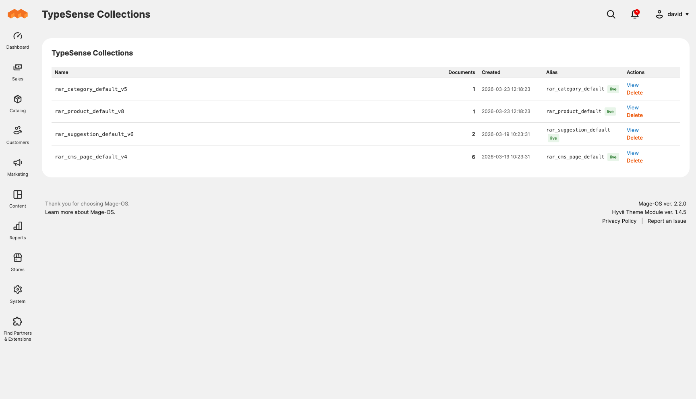

# RunAsRoot Magento 2 TypeSense

[](https://github.com/run-as-root/Typesense-Magento-2/actions/workflows/ci.yml)
[](https://github.com/run-as-root/Typesense-Magento-2/actions/workflows/e2e.yml)


Open-source [Typesense](https://typesense.org) search integration for Magento 2 / Mage-OS with visual merchandising, zero-downtime reindexing, and Hyva-native frontend components.

---

## Screenshots

### Admin Dashboard


### Admin Configuration


### Collection Browser


### Visual Category Merchandiser


### Synonym Management


### Frontend — Category Page


---

## Features

- Full-text search powered by Typesense with typo tolerance and instant results
- Zero-downtime reindexing using collection versioning and atomic alias swaps
- Multi-entity indexing: products, categories, CMS pages, search suggestions, orders, customers, store, and system config
- Hyva-compatible autocomplete (CSP-safe Alpine.js) with multi-index results
- Instant search page replacing the default Magento catalog search
- Category page powered by Typesense with client-side filtering and sorting
- Visual category merchandiser on the category edit page (Algolia-style sortable product table)
- Virtual categories with rule-based product membership, resolved at query time with no reindex required
- Admin query merchandiser for keyword-level product promotion/demotion
- Boosting rules that raise or lower products matching admin-built conditions in the relevance order
- Relevance tuning: weighted searchable attributes, typo/prefix/split-join parameters, infix search, stemming, German decompounding and direct matches ranked above synonym matches
- Admin synonym manager and collection browser
- CLI commands for reindexing, collection management, and health checks
- Cron-based and message-queue-based background reindexing
- Conversational search (RAG) with AI-generated answers powered by OpenAI + Typesense embeddings
- Product recommendations on the product detail page using vector similarity search
- Admin AI Assistant with 24 agentic analytics tools (customer segmentation, inventory forecasting, cohort analysis, and more)
- CSP whitelist for Typesense API endpoints
- Configurable per store view

---

## Requirements

| Dependency | Version |
|---|---|
| PHP | 8.3+ |
| Magento 2 / Mage-OS | 2.4.7+ |
| Magento Inventory (MSI) modules | enabled (product stock comes from `IsProductSalableInterface`) |
| Typesense | 27+ |
| Hyva Theme | 1.3+ |
| typesense/typesense-php | ^6.0 |
| run-as-root/german-compound-splitter | ^1.0 |

---

## Installation

Until both packages are published on Packagist, add their GitHub repositories to your project first:

```bash
composer config repositories.magento2-typesense vcs https://github.com/run-as-root/Typesense-Magento-2
composer config repositories.german-compound-splitter vcs https://github.com/run-as-root/german-compound-splitter
```

```bash
composer require run-as-root/magento2-typesense
bin/magento setup:upgrade
bin/magento setup:di:compile
```

For production:

```bash
bin/magento setup:static-content:deploy
bin/magento cache:flush
```

---

## Configuration

Navigate to **Stores > Configuration > TypeSense > TypeSense Search**.

### General Settings

| Setting | Default | Description |
|---|---|---|
| Enable TypeSense Search | No | Master switch for the module |
| Protocol | http | `http` or `https` for server-side (PHP) requests |
| Host | localhost | Internal hostname for indexing (e.g., `typesense` in Docker) |
| Port | 8108 | Typesense server port |
| Admin API Key | — | Server-side admin key (never exposed to frontend) |
| Search-Only API Key | — | Public key used for frontend search requests |
| Frontend Search Protocol | — | Override protocol for browser-side requests (useful in Warden/Docker setups) |
| Frontend Search Host | — | Public hostname the browser uses to reach Typesense |
| Frontend Search Port | — | Override port for browser-side requests |
| Index Prefix | rar | Prefix for all collection names |
| Enable Logging | No | Logs search queries and indexing activity |

### Indexing Settings

| Setting | Default | Description |
|---|---|---|
| Batch Size | 200 | Documents per import batch |
| Index Products | Yes | Enable product indexing |
| Index Categories | Yes | Enable category indexing |
| Index CMS Pages | Yes | Enable CMS page indexing |
| Index Suggestions | Yes | Enable search suggestion indexing |
| Additional Attributes to Index | — | Extra product attributes to include in the Typesense index (see below) |
| Zero-Downtime Reindex | Yes | Use alias swap strategy for live reindexing |
| Enable Cron Reindex | No | Schedule automatic reindexing |
| Cron Schedule | `0 2 * * *` | Cron expression for scheduled reindex |
| Enable Queue Reindex | No | Use message queue for async reindexing |

### Search Settings

Store-view scope. These drive the search page, autocomplete product results and (with "Replace Category Pages") category listings. Settings marked "Reindex" change the collection schema: run `bin/magento typesense:reindex --entity=product` after changing them. Searches can fail until that reindex has finished. Schema changes (infix, stemming, decompounding) only take effect with Zero-Downtime Reindex enabled, which builds a new collection; without it the existing collection is reused, so delete it first (`typesense:collection:delete`). Flush the full page cache after the reindex, because cached pages still send the old search parameters.

| Setting | Default | Description |
|---|---|---|
| Enable Typo Tolerance | Yes | `num_typos` 2 when on, 0 when off |
| Text Match Type | Max Weight | How the text-match score is combined across fields (`text_match_type`: `max_weight`, `max_score`, `sum_score`) |
| Searchable Attributes | name 10, sku 9, description 1 | Rows of attribute + weight; become `query_by` / `query_by_weights` in weight order. Options are name, SKU, description, short description, categories, "Name (decompounded)" and every additional indexed attribute. Attributes that are not indexed are dropped; an empty list falls back to `name` |
| Drop Tokens Threshold | 0 | Drop query words when fewer results than this are found (0 disables) |
| Typo Tokens Threshold | 1 | Search typo-corrected matches only when exact matches return fewer results than this |
| Minimum Word Length for 1 Typo | 5 | `min_len_1typo` (shown when typo tolerance is on) |
| Minimum Word Length for 2 Typos | 8 | `min_len_2typo` (shown when typo tolerance is on) |
| Prioritize Exact Matches | Yes | `prioritize_exact_match` |
| Split/Join Words | Fallback | Match "smart watch" against "smartwatch" (`split_join_tokens`: `fallback`, `always`, `off`) |
| Enable Prefix Search | Yes | Match the last query word as a prefix |
| Enable Infix Search | No | Match query words inside other words. Reindex |
| Infix Search Fields | name | Fields that get the infix flag; the `infix` request parameter is `off` for every other `query_by` field. Reindex |
| Infix Search Mode | Fallback | `fallback` uses infix matching only when the normal search finds nothing; `always` combines both |
| Enable Stemming | Yes | `stem` flag on the full-text fields (name, description, short description, categories text, "Name (decompounded)"), so word variants match. SKU, category paths, type and additional (facet) attributes are never stemmed, so their filters stay exact. Reindex |
| Show Direct Matches First | Yes | Products matching the query itself rank above synonym-only matches (search page and autocomplete, relevance sort only). Costs one extra search per query |
| Enable Server-Side Search Cache | Yes | Typesense caches identical search requests in memory (`use_cache`) |
| Search Cache TTL (seconds) | 300 | `cache_ttl` |
| Boosting Rule Text Match Buckets | 10 | `_text_match(buckets: N)` used with boosting rules (see [Boosting Rules](#boosting-rules)) |
| German Decompounding | No | Index the product name plus the tails of its German compound words ("Treppensackkarre" → "Treppensackkarre Sackkarre Karre") in `name_decompounded`. Add "Name (decompounded)" to Searchable Attributes to search it, but only after the full reindex has finished: a row added earlier makes every search in the store fail. Reindex |
| Never Split Words Of | — | Product attribute whose words (e.g. a product line name) are never split. Reindex |

### Instant Search Settings

| Setting | Default | Description |
|---|---|---|
| Enable Instant Search | Yes | Replace the Magento search results page |
| Products Per Page | 12 | Results per page on the search results page |
| Product Tile Attributes | — | Attributes displayed on product cards (must also be indexed) |
| Sort Options | relevance, price asc/desc, newest | Sort options available to customers (see below) |
| Facet Filters | — | Facets shown in the filter bar: additional attributes plus Price, Availability (`in_stock`) and New (`is_new`). Category pages always get the subcategory filter |
| Facet Types | — | Per facet: dropdown, checkbox (Yes/No fields) or slider (Price only), and "Value Search" for dropdowns. Price defaults to a slider |
| Show Out-of-Stock Products Last | Yes | Sorts by `in_stock:desc` before the chosen sort |
| Replace Category Pages | No | Use Typesense for category product listings (not for "Static block only" categories) |
| Cacheable Search Page | Yes | Serve the search page as a full-page-cacheable shell; search terms are logged from the browser |
| Image Type | `category_page_grid` | Magento image id used for the indexed, resized `image_url` |
| Image Width / Height | 300 | `width`/`height` attributes of tile images |
| No Results: Suggested Products Category ID | — | Products of this category are shown below the "no results" message |
| SEO Text Selector | `.page-bottom .category-description` | Element hidden on category pages after the first page |

### Autocomplete Settings

| Setting | Default | Description |
|---|---|---|
| Enable Autocomplete | Yes | Show autocomplete dropdown on search input |
| Product Count | 6 | Max product results in autocomplete |
| Category Count | 3 | Max category results |
| CMS Page Count | 2 | Max CMS page results |
| Suggestion Count | 4 | Max query suggestion results |
| Group Products By | — | Faceted product field sent as `group_by` (one product per value); ignored when not a faceted schema field |

### Tracking Settings

| Setting | Default | Description |
|---|---|---|
| Push GA4 Events to the dataLayer | No | Maps the `typesense:*` window events to `view_item_list`, `select_item`, `search_suggestion_click`, `sorting_interaction` and `filter_interaction` |

### Conversational Search (AI) Settings

| Setting | Default | Description |
|---|---|---|
| Enable Conversational Search | No | Show AI-generated answers above search results |
| OpenAI API Key | — | API key for answer generation (get one at platform.openai.com) |
| OpenAI Model | gpt-4o-mini | Model used for generating answers |
| System Prompt | — | Instructions for the AI assistant's tone and behavior |
| Embedding Source Fields | name, description | Product fields used to generate semantic embeddings |
| Conversation TTL | 86400 | How long conversation history is kept (seconds) |

### Product Recommendations Settings

| Setting | Default | Description |
|---|---|---|
| Enable Recommendations | No | Show similar products on the product detail page |
| Number of Products | 8 | Maximum recommended products to display |

> **Note:** Product Recommendations require Conversational Search to be enabled, as they use the same product embeddings for vector similarity search. The admin UI enforces this: the Product Recommendations fields are hidden until Conversational Search is turned on, keeping the admin state aligned with the backend gate (`isRecommendationsEnabled()`).

### Admin AI Assistant Settings

| Setting | Default | Description |
|---|---|---|
| Enable Admin AI Assistant | No | Activate the agentic AI chat in the admin panel |
| System Prompt | — | Instructions for the AI assistant's tone, behavior, and data model context |
| OpenAI Model | gpt-4o | Model used for function calling and answer generation (inherits from Conversational Search if empty) |
| Conversation TTL | 86400 | How long conversation history is retained (seconds) |

> **Note:** The Admin AI Assistant requires Conversational Search to be enabled with a valid OpenAI API key. The assistant uses the same API key configured under Conversational Search.

---

## Configurable Attributes

### Additional Attributes to Index

Navigate to **Stores > Configuration > TypeSense > TypeSense Search > Indexing > Additional Attributes to Index**.

Select any product attributes you want included in the Typesense product documents. Core fields (name, SKU, price, description, URL, images, categories) are always indexed. Use this to add attributes like `color`, `size`, `brand`, `material`, or any custom attribute.

Attributes are grouped by input type (select/multiselect, boolean, numeric, text) so you can quickly identify which ones make sense to index or use as facets. Each entry shows the attribute label, code, and input type — for example: `Color (color) — select`.

Changes to this setting require a full product reindex to take effect.

### Product Tile Attributes

Navigate to **Stores > Configuration > TypeSense > TypeSense Search > Instant Search > Product Tile Attributes**.

Select which attributes from your indexed set should be visible on product cards in search results and category pages. An attribute must appear in "Additional Attributes to Index" before it can be displayed on tiles.

### Sort Options

Navigate to **Stores > Configuration > TypeSense > TypeSense Search > Instant Search > Sort Options**.

Choose which sort options are available to customers on search results and category pages. Available options:

| Option | Description |
|---|---|
| Relevance | Default Typesense relevance ranking |
| Price: Low to High | Ascending price |
| Price: High to Low | Descending price |
| Newest | Most recently created products |
| Name: A–Z | Alphabetical ascending |
| Name: Z–A | Alphabetical descending |
| Best Selling | Based on sales order data |
| Top Rated | Based on review ratings |
| Most Reviewed | Based on review count |

---

## CLI Commands

| Command | Description |
|---|---|
| `bin/magento typesense:reindex [--entity=TYPE]` | Reindex all or a specific entity type into Typesense. Valid types: `product`, `category`, `cms_page`, `suggestion` |
| `bin/magento typesense:collection:list` | List all Typesense collections with document count and alias mappings |
| `bin/magento typesense:collection:delete <name>` | Delete a named Typesense collection |
| `bin/magento typesense:health` | Check the health status of the Typesense server |

### Examples

```bash
# Full reindex of all entity types
bin/magento typesense:reindex

# Reindex only products
bin/magento typesense:reindex --entity=product

# List collections to inspect index state and verify alias assignments
bin/magento typesense:collection:list

# Check server connectivity before indexing
bin/magento typesense:health
```

---

## Indexing

### How It Works

The indexer pipeline is split into three layers:

1. **EntityIndexer** — per entity type; fetches records and builds document arrays
2. **IndexerOrchestrator** — coordinates collection creation, batched import, and alias management
3. **BatchImportService** — chunks documents and sends them to Typesense's bulk import API

### Entity Types

| Entity | Collection Pattern | Magento Indexer ID |
|---|---|---|
| Products | `<prefix>_product_v<n>` | `typesense_product` |
| Categories | `<prefix>_category_v<n>` | `typesense_category` |
| CMS Pages | `<prefix>_cms_page_v<n>` | `typesense_cms_page` |
| Suggestions | `<prefix>_suggestion_v<n>` | `typesense_suggestion` |
| Orders | `<prefix>_order_v<n>` | `typesense_order` |
| Customers | `<prefix>_customer_v<n>` | `typesense_customer` |
| Store | `<prefix>_store_v<n>` | `typesense_store` |
| System Config | `<prefix>_system_config_v<n>` | `typesense_system_config` |

Collections are suffixed with a version number (e.g., `rar_product_v2`) so that the live collection pointed to by the alias is never written to during a reindex.

### Zero-Downtime Reindexing

When zero-downtime reindexing is enabled:

1. `ZeroDowntimeService::startReindex()` creates a new versioned collection (e.g., `rar_product_v2` while `rar_product` alias points at `rar_product_v1`)
2. All documents are indexed into the new versioned collection
3. `ZeroDowntimeService::finishReindex()` atomically swaps the alias to point at the new collection, keeps the previously live collection as a rollback target, and deletes older versions

This means the live alias (`rar_product`) always points at a fully populated collection. If a new version turns out bad, `bin/magento typesense:collection:rollback --entity=<type> --store=<code>` points the alias back to the previous version.

### Magento Indexer Integration

The module registers standard Magento indexers and supports incremental updates via MView (MySQL change log). After configuration changes or new product saves, the relevant indexer is flagged and can be reindexed via the standard `bin/magento indexer:reindex` command.

---

## Merchandising

All merchandising is powered by [Typesense Curation](https://typesense.org/docs/guide/curations.html) override rules synced from the Magento admin.

### Visual Category Merchandiser

The category merchandiser is embedded directly on the **Catalog > Categories** edit page — no separate admin screen needed.

On any category's edit page, scroll to the **TypeSense Merchandising** section to find an Algolia-style sortable product table. You can:

- Drag and drop products to pin them to specific positions
- Promote products to the top of the category listing
- Demote or hide specific products

Changes are saved alongside the category and sync to Typesense curation rules on save.

### Virtual Category (Rule-Based Categories)

On any category's edit page, toggle **Virtual Category** and build a rule with Magento's native nested AND/OR condition builder — the same rule engine used by Catalog Price Rules, limited to attributes present in the Typesense product schema. A virtual category's product membership is computed from that rule instead of manual assignment.

Rules resolve at query time: the condition tree compiles into a Typesense `filter_by` clause that swaps in for the category's normal product filter, so there's no reindex after saving a rule. A category can also be set up as a **virtual root**, mirroring another category's matches (optionally narrowed by its own rule), and virtual categories always fold in matches from their own child categories (**anchor bleed-up**). Pinning and hiding products via the Visual Category Merchandiser continues to work on virtual categories exactly as it does on static ones.

### Query Merchandiser

Navigate to **Content > TypeSense > Query Merchandiser**.

Promote or bury products for specific search queries. Each rule targets a keyword and specifies pinned (top positions) or hidden product IDs.

### Boosting Rules

Navigate to **Stores > TypeSense > Boosting Rules**.

A boosting rule moves every product matching its conditions up or down the relevance order, for all queries. Conditions use the same condition builder and attributes as virtual categories. Each rule has:

- **Weight**: a non-zero whole number. A positive weight boosts matching products, a negative weight demotes them; the larger the number, the stronger the effect.
- **Store View**: one store view, or "All Store Views" (store 0), which applies the rule in every store view alongside that store's own rules.
- **Apply to Search Results** (search page and autocomplete) and **Apply to Category Listings** (Typesense category pages, needs "Replace Category Pages").
- **From / To**: an optional date window, inclusive and in the store's timezone. An empty date leaves that side open.

The store's active rules for the context are compiled into the relevance sort: `_text_match(buckets: N):desc,_eval([(<rule filter>):<weight>, …]):desc`. They apply only while the customer keeps the relevance sort; choosing another sort option ignores them. Rules reorder products only within the same text-match bucket, so a boosted product never jumps above much better matches. "Boosting Rule Text Match Buckets" (Search Settings, default 10) sets N: fewer buckets give rules more influence. With few results, each bucket holds one or two products and a rule barely moves anything.

Limitations:

- Typesense's `_eval` parser cannot read parentheses inside condition values (e.g. SKU is `Birne (alt)`): such a rule would break every search, so it is skipped and logged as a warning, and saving it shows a warning. Rules without conditions, or whose conditions do not compile, are skipped the same way.
- Saving or deleting a rule cleans the full page cache, since the sort is rendered into the page. A date window starting or ending later only takes effect once cached pages expire.

---

## Frontend

All frontend components require the Hyva theme. They use Alpine.js for reactivity and make direct Typesense API calls using the public search-only API key. All components are written to be CSP-compatible — no inline `eval()` or dynamic script injection.

### Autocomplete

Replaces the template of Hyvä's `header-search` block (handle `typesense_autocomplete`, also over Hyva_SmileElasticsuite's) with `search/form-mini.phtml`: a GET form to the search page plus a dropdown with query suggestions, products, categories and CMS pages from one multi search, highlighted matches, "See all (N)" and keyboard navigation. Typesense errors hide the dropdown; Enter still submits the form. Configured via the autocomplete settings in admin.

### Instant Search Page

Replaces the Magento search results page (`/catalogsearch/result`) with the storefront listing below (handle `typesense_search_result`, added only while the module and instant search are enabled). With "Cacheable Search Page" on, a URL holding only listing parameters (`q`, `page`, `sort`, `limit`, `price` and configured facets) is answered by a cacheable shell instead of the core search action, and the term is logged from the browser through `catalogsearch/searchTermsLog/save`. Search terms with a redirect URL still redirect.

Other `around` plugins on `Magento\CatalogSearch\Controller\Result\Index` that are declared before ours still wrap the shell. Smile ElasticSuite's `search_term_and_single_result_redirect` is one: with "Redirect to product page if only one result" on, it runs an ElasticSuite query on every search page and redirects whenever that query finds a single product, whatever Typesense finds. Turn `smile_elasticsuite_catalogsearch_settings/catalogsearch/redirect_if_one_result` off on Typesense stores.

### Category Page

When "Replace Category Pages" is on, Typesense category pages (handle `typesense_category_search`) use the same listing, filtered by `category_ids` (anchor categories include their subtree) and visibility catalog/both. Filtering, sorting and pagination happen in the browser against Typesense; Magento's product collection is never loaded for the listing.

### Storefront Listing

The search and category listings share the `typesense_listing` handle: one Alpine CSP component `typesenseListing` (template `listing/listing.phtml`) built from child-block slots. Override a slot by pointing its block at your own template in a theme or module layout (`<referenceBlock name="typesense.listing.tile.price" template="Vendor_Module::listing/tile/price.phtml"/>`), or copy the template into the theme under `RunAsRoot_TypeSense/templates/<path>`.

| Slot (alias) | Block name | Default template |
|---|---|---|
| `filters` | `typesense.listing.filters` (container) | `listing/filters/bar.phtml` with `skeleton`, `drawer`, `active-filters` |
| drawer children | `typesense.listing.filters.{sorting-mobile,subcategory,dropdown,slider,checkbox}` | `listing/filters/*.phtml` (arguments `visible_values`, `group_label`) |
| `toolbar` | `typesense.listing.toolbar` (container) | `listing/filters/sorting.phtml`, `listing/filters/page-size.phtml` |
| `ai-answer` | `typesense.listing.ai-answer` | `listing/ai-answer.phtml` |
| `products-count` | `typesense.listing.products-count` | `listing/products-count.phtml` |
| `loading-overlay` | `typesense.listing.loading-overlay` | `listing/loading-overlay.phtml` |
| `grid` | `typesense.listing.grid` with `skeleton` (`placeholder_count`, default 8) and `tile` | `listing/grid.phtml`, `listing/skeleton.phtml` |
| tile slots | `typesense.listing.tile.{image,badges,wishlist,rating,price,variants,actions}` | `listing/tile/*.phtml` |
| `no-results` | `typesense.listing.no-results` with its own `tile` tree (`typesense.listing.no-results.tile.*`) | `listing/no-results.phtml` |
| `pagination` | `typesense.listing.pagination` | `listing/pagination.phtml` |
| `script` | `typesense.listing.script` (+ `.events`, `.getters`, `.extras`, `.tile`, `.tile.requests`) | `listing/script.phtml`, `listing/script/*.phtml`, `listing/tile/script*.phtml` |
| `json-ld` | `typesense.listing.json-ld` | `listing/json-ld.phtml` (ItemList on category pages) |

The listing block takes `eager_load_images_count` (default 4). `listing-core.js` (`window.runAsRootTypesense.listing`) holds the logic (filters, URL state, facet counts, GA4 items) and is loaded once, deferred in the head, by `typesense.listing.core` on pages whose handle sets its `is_required` argument. Child components read the listing state from the `typesense-state` window event (`typesenseListingState()` mixin) and change it by dispatching `typesense-filter-change`, `typesense-sort-change`, `typesense-limit-change` and `typesense-page-change`.

URL state uses `q`, `page`, `sort` (e.g. `price:asc`), `limit`, `price` (`min-max`) and one parameter per facet field with values joined by `|`. Unknown keys are dropped, invalid values fall back to the defaults and `page` is clamped to the available pages.

#### JSON config

Each listing renders its config as JSON in `<script type="application/json" data-typesense-listing-config>` (`ListingConfigViewModel::getJsonConfig()`). Plug the view model to change it.

| Key | Content |
|---|---|
| `connection` | `host`, `port`, `protocol`, `apiKey` (search-only key) of the browser-side node |
| `productCollection` | Store's product alias, e.g. `rar_product_de` |
| `context`, `categoryId`, `listName` | `search` or `category`, the category id, the GA4 list name (category name or "Search Results") |
| `baseFilter` | `filter_by` every search starts from (category ids or virtual rule, visibility) |
| `facets` | `[{field, label, type, searchable, boolean, numeric, prefix?}]`; `type` is `dropdown`, `checkbox`, `slider` or `subcategory`, `numeric` is `int32`/`int64`/`float` or `false` |
| `maxFacetValues` | `max_facet_values` sent to Typesense (50) |
| `sortOptions`, `defaultSort` | `[{label, value}]` (`value` is a Typesense `sort_by`, `''` = relevance) and the category's default |
| `limits`, `perPage` | Page sizes from the catalog grid settings and the default |
| `inStockFirst` | Prepend `in_stock:desc` to every sort |
| `requestParams`, `cacheParams`, `relevanceSortBy`, `directMatchesFirst` | Search parameters, cache options, boosting-rule sort and direct-match ranking (see Search Settings) |
| `conversationalSearch` | `{enabled, modelId}` |
| `currencyCode`, `locale`, `showPrices`, `showRatings` | Formatting; `showPrices` follows `ListingConfigViewModel::canShowPrices()` |
| `addToCartUrl`, `wishlistEnabled`, `wishlistAddUrl`, `wishlistUrl` | Tile actions (POST with form key) |
| `imageWidth`, `imageHeight`, `noResultsCategoryId`, `seoTextSelector` | See Instant Search Settings |

The header search reads `<script type="application/json" data-typesense-autocomplete-config>` (`AutocompleteConfigViewModel`): collections, counts, `minQueryLength`, `searchUrl`, `groupBy`, highlight and price settings.

#### Window events

The listing and the header search dispatch these `CustomEvent`s on `window`. Listen to them for tracking instead of wrapping the Typesense client.

| Event | When | `detail` |
|---|---|---|
| `typesense:results` | After every rendered result | `{context, listName, page, stateKey, items, documents}`; `items` are GA4 items (`item_id` = SKU, `item_name`, `price` when shown and > 0, `index`, `item_list_name`), `stateKey` the serialized URL state |
| `typesense:select-item` | Shopper clicks a tile link | `{item, index, listName, document}` |
| `typesense:suggestion-click` | Shopper clicks a header-search row | `{type, term, name, url, index, item?}`; `type` is `product`, `category`, `page` or `suggestion`, `item` only for products |
| `typesense:sort-change` | Shopper changes the sort | `{context, listName, sort, previous}` |
| `typesense:filter-change` | Shopper adds or removes filters | `{context, listName, added, removed}` with `{field, value}` entries (price as `min-max`) |

#### GA4 dataLayer

With "Push GA4 Events to the dataLayer" on, `tracking/ga4.phtml` maps the events to `window.dataLayer`, each push preceded by `{ecommerce: null}`:

| Event | dataLayer push |
|---|---|
| `typesense:results` | `{event: 'view_item_list', ecommerce: {item_list_name, items}}`, once per listing state, never for empty results |
| `typesense:select-item` | `{event: 'select_item', ecommerce: {item_list_name, items: [item]}}` |
| `typesense:suggestion-click` | `{event: 'search_suggestion_click', search_term, suggestion_type, suggestion_name, suggestion_url (path only), index, ecommerce?: {item_list_name: 'search_suggestions', items}}` |
| `typesense:sort-change` | `{event: 'sorting_interaction', sorting_option}` (`relevance` for the default) |
| `typesense:filter-change` | `{event: 'filter_interaction', filter_type, filter_value}` per added filter, plus one with `filter_type: 'filter_deactivation'` when filters were removed |

Projects with their own item shape leave the setting off and listen to the window events.

#### Index requirements

Grouped tiles read `children` (`object[]`), which needs a product collection created with `enable_nested_fields: true`. The flag can only be set when a collection is created, so after upgrading run a full product reindex (`bin/magento typesense:reindex --entity=product`) with Zero-Downtime Reindex on, or delete the product collections first without it. The same reindex adds the `price` facet (slider stats), sortable `in_stock`, `is_new`, the ancestor category paths in `categories.lvlN` and the anchor ancestors in `category_ids`.

#### Hyvä Tailwind CSS

The module's templates use Tailwind classes that are only in the CSS once the theme is rebuilt with them:

1. The module registers itself for Hyvä's config (`hyva_config_generate_before`). Run `bin/magento hyva:config:generate` (`setup:upgrade` also does it) and check that `app/etc/hyva-themes.json` lists the module path (`vendor/run-as-root/magento2-typesense`, or the path-repository directory). Make sure the theme's `web/tailwind/hyva.config.json` does not exclude it.
2. Rebuild the theme CSS in `<theme>/web/tailwind`: `npm run build` (Tailwind v4 themes regenerate `generated/hyva-source.css`, which then holds an `@source` for the module and imports its `view/frontend/tailwind/tailwind-source.css`; Tailwind v3 themes merge `view/frontend/tailwind/tailwind.config.js` through `@hyva-themes/hyva-modules`).
3. Deploy static content (production) or flush caches. Repeat step 2 after every module upgrade that changes templates.

### Conversational Search (AI)

When enabled with an OpenAI API key, search results include an AI-generated answer box above the product grid. Uses Typesense's built-in embedding model (`ts/all-MiniLM-L12-v2`) for semantic search and OpenAI for answer generation. Configurable model, system prompt, and embedding source fields.

### Product Recommendations

When enabled, a "You May Also Like" slider appears on every product detail page. Uses Typesense vector similarity search to find semantically similar products based on the current product's embedding — no manual curation needed. Requires Conversational Search to be enabled (for embeddings). The number of recommended products is configurable in admin.

---

## Admin AI Assistant

The Admin AI Assistant is an agentic analytics tool built into the Magento admin panel. It uses OpenAI function calling to intelligently query your store data — deciding which tools to invoke, executing them, and synthesizing the results into a conversational answer.

### How It Works

1. You type a question in the admin chat panel (e.g., "What are my best-selling products this quarter?")
2. The assistant sends your question plus tool definitions to OpenAI
3. OpenAI decides which tools to call (e.g., `product_velocity`, `compare_periods`)
4. PHP executes the tools and sends results back to OpenAI
5. The loop repeats (up to 10 iterations) until a final answer is generated

### Available Tools (24)

| Category | Tools |
|---|---|
| **Data Access** | `execute_sql` (read-only sandbox), `describe_database`, `search_typesense` |
| **Time Intelligence** | `compare_periods`, `trend_analysis` |
| **Customer Intelligence** | `customer_segmentation` (RFM), `cohort_analysis`, `customer_lifetime_value`, `customer_churn_risk`, `customer_concentration_risk`, `customer_purchase_journey` |
| **Product Intelligence** | `frequently_bought_together`, `inventory_forecast`, `product_velocity`, `profit_analysis` |
| **Marketing & Attribution** | `discount_effectiveness`, `revenue_attribution`, `funnel_analysis` |
| **Operational** | `geographic_performance`, `time_pattern_analysis`, `shipping_performance`, `returns_analysis`, `basket_analysis`, `detect_anomalies` |

### Security

- SQL execution is sandboxed: SELECT-only, blocked sensitive tables/columns, 100-row limit, 5-second timeout
- Rate limited: 100 requests/hour per admin user
- All queries are audit-logged with context
- System prompt and tool call internals are filtered from responses
- Agent loop has a 60-second wall-clock timeout
- ACL-protected: requires `RunAsRoot_TypeSense::ai_assistant` permission

### Additional Indexers

The assistant indexes four additional entity types into Typesense beyond the standard search collections:

| Entity | Purpose |
|---|---|
| Orders | Revenue, fulfillment, and basket analytics |
| Customers | Segmentation, LTV, and churn analysis |
| Store | Store configuration context |
| System Config | Non-sensitive configuration entries |

---

## Extending

### Adding a Custom Entity Indexer

1. Implement `RunAsRoot\TypeSense\Api\EntityIndexerInterface`:

```php
<?php

declare(strict_types=1);

namespace Vendor\Module\Model\Indexer;

use RunAsRoot\TypeSense\Api\EntityIndexerInterface;

class BlogPostEntityIndexer implements EntityIndexerInterface
{
    public function getEntityType(): string
    {
        return 'blog_post';
    }

    public function getIndexerCode(): string
    {
        return 'vendor_module_blog_post';
    }

    public function getSchemaFields(): array
    {
        return [
            ['name' => 'id', 'type' => 'string'],
            ['name' => 'title', 'type' => 'string'],
            ['name' => 'content', 'type' => 'string'],
        ];
    }

    public function buildDocuments(array $entityIds, int $storeId): iterable
    {
        // Fetch and yield document arrays
        yield ['id' => '1', 'title' => 'Hello World', 'content' => '...'];
    }
}
```

2. Register in your module's `etc/di.xml`:

```xml
<type name="RunAsRoot\TypeSense\Model\Indexer\EntityIndexerPool">
    <arguments>
        <argument name="indexers" xsi:type="array">
            <item name="blog_post" xsi:type="object">Vendor\Module\Model\Indexer\BlogPostEntityIndexer</item>
        </argument>
    </arguments>
</type>
```

3. Run `bin/magento setup:di:compile`.

Your entity type is now available to `typesense:reindex --entity=blog_post` and to the orchestrator for full and partial reindexing.

---

## Development

### Setup

```bash
# Clone the repository
git clone git@github.com:run-as-root/Typesense-Magento-2.git

# Install dependencies
composer install

# Run static analysis
vendor/bin/phpstan analyse

# Run unit tests
vendor/bin/phpunit --testsuite Unit

# Run integration tests (requires running Typesense + Magento)
vendor/bin/phpunit --testsuite Integration --group integration

# Run E2E tests (requires Warden environment with indexed data)
cd tests/e2e && npm install && npx playwright install chromium
npx playwright test

# Run E2E tests in UI mode (interactive debugging)
npx playwright test --ui
```

### Architecture Overview

```
├── Api/                        Interfaces (EntityIndexerInterface, etc.)
├── Block/                      Admin blocks
├── Console/Command/            CLI commands (reindex, collection:list, etc.)
├── Controller/                 Admin AJAX controllers
├── Cron/                       Scheduled reindexing job
├── Model/
│   ├── Client/                 TypeSenseClientFactory (wraps typesense-php)
│   ├── Collection/             CollectionManager, AliasManager, ZeroDowntimeService
│   ├── Config/                 TypeSenseConfig, source models
│   ├── Curation/               Sync services for merchandising rules
│   ├── Indexer/                Entity indexers and orchestrator
│   └── Merchandising/          ORM models and repositories
├── Observer/                   Layout load observer for CSP / frontend injection
├── Plugin/                     CSP dynamic collector
├── Queue/Consumer/             Message queue consumer for async reindexing
├── Test/
│   ├── Unit/                   PHPUnit unit tests
│   └── Integration/            Integration test stubs (@group integration)
├── tests/e2e/                     Playwright E2E tests (Page Object Models + specs)
├── Ui/                         Magento UI component data providers
├── view/adminhtml/             Admin layout, templates, JS
├── view/frontend/              Hyva layout, Alpine.js components
└── ViewModel/                  View models for admin and frontend templates
```

### Code Standards

- PHP 8.3+ features (readonly properties, enums, fibers where appropriate)
- Final classes throughout — prefer composition over inheritance
- `declare(strict_types=1)` in every file
- snake_case test method names
- All public methods covered by unit tests
- PHPStan level 6

---

## Contributing

1. Fork the repository
2. Create a feature branch: `git checkout -b feature/my-feature`
3. Write tests first (TDD)
4. Implement the feature
5. Ensure all tests pass: `vendor/bin/phpunit --testsuite Unit`
6. Run static analysis: `vendor/bin/phpstan analyse`
7. Submit a pull request against `main`

Please keep pull requests focused. One feature or fix per PR.

---

## License

MIT — see [LICENSE](LICENSE) for full text.
